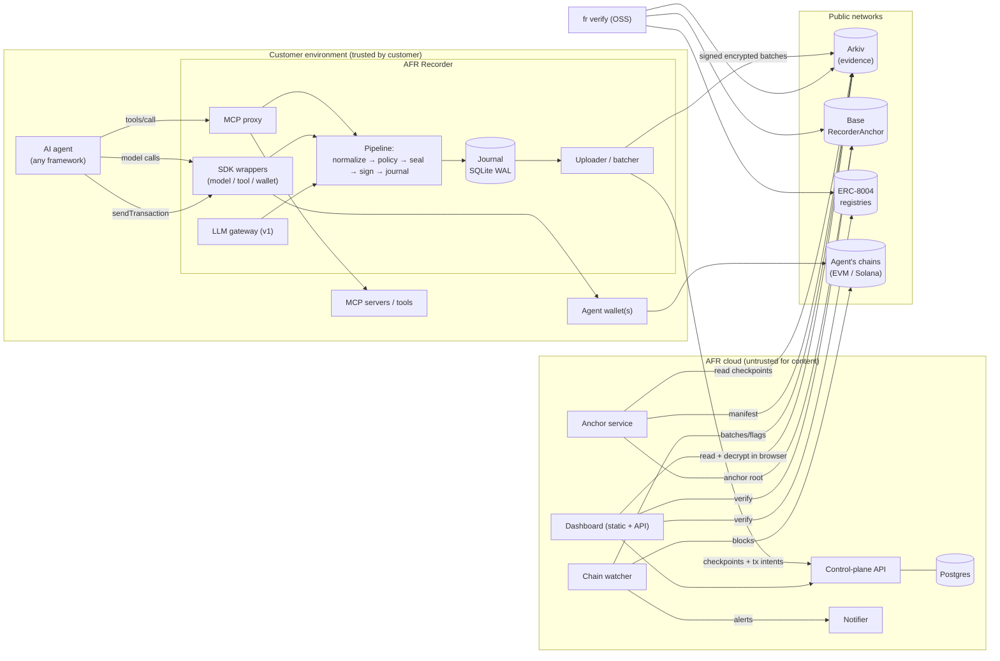
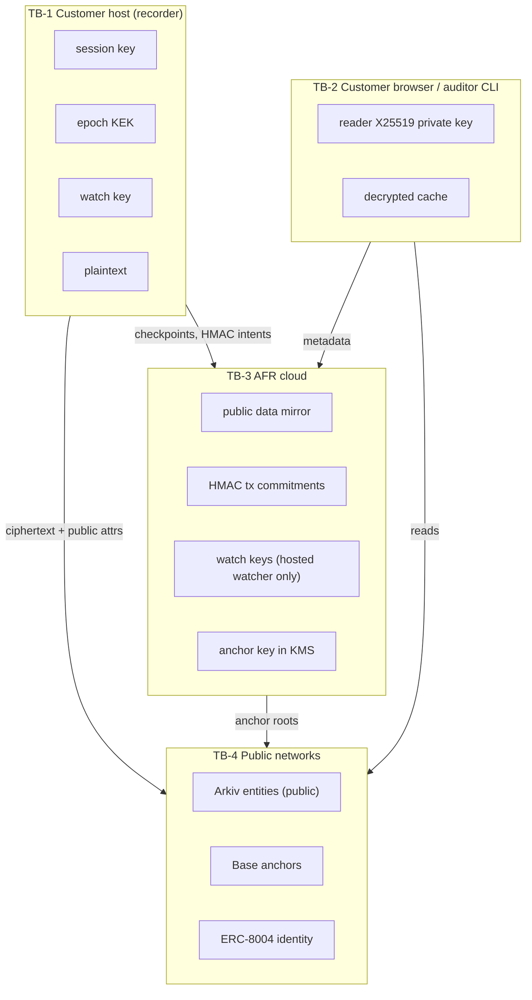
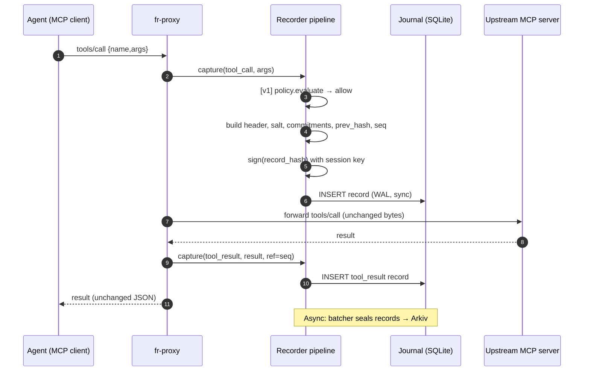
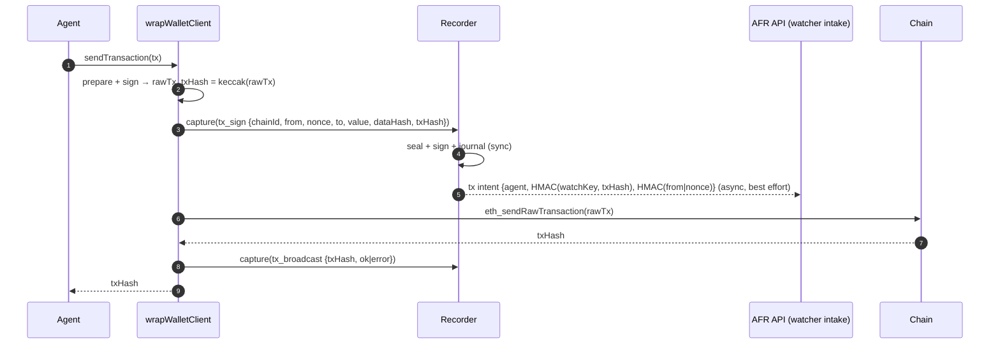
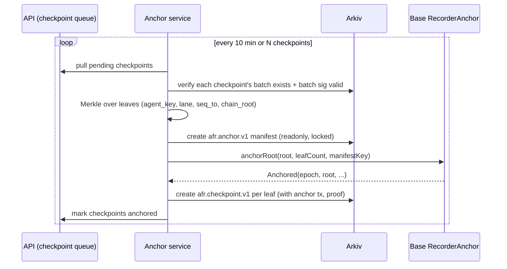

# Agent Flight Recorder — Architecture Design Document

| | |
|---|---|
| **Status** | Draft v1.0 · 2026-11-01 |
| **Audience** | Engineers, AI coding agents, security reviewers, auditors |
| **Normative?** | Yes. Sections marked **[NORMATIVE]** define wire formats and algorithms. Implementations and the verifier MUST match them byte for byte. Everything else is guidance. |
| **Related** | [PRD](../00-product/PRD.md) · [ADRs](ADRS.md) · [Layer specs](../02-layers/) · [Phase plans](../03-phases/) |

---

## Table of contents

1. [Context and goals](#1-context-and-goals)
2. [System overview](#2-system-overview)
3. [Layered architecture](#3-layered-architecture)
4. [Components](#4-components)
5. [Trust boundaries and deployment topology](#5-trust-boundaries-and-deployment-topology)
6. [Core data flows](#6-core-data-flows)
7. [Data model summary](#7-data-model-summary)
8. [Cryptography summary [NORMATIVE]](#8-cryptography-summary-normative)
9. [Arkiv integration summary](#9-arkiv-integration-summary)
10. [Base anchoring and ERC-8004 summary](#10-base-anchoring-and-erc-8004-summary)
11. [Watcher summary](#11-watcher-summary)
12. [Performance and cost model](#12-performance-and-cost-model)
13. [Reliability and failure modes](#13-reliability-and-failure-modes)
14. [Security architecture and threat model](#14-security-architecture-and-threat-model)
15. [Technology stack](#15-technology-stack)
16. [Repository layout](#16-repository-layout)
17. [Versioning and compatibility](#17-versioning-and-compatibility)
18. [Observability](#18-observability)
19. [Testing strategy](#19-testing-strategy)
20. [Environments](#20-environments)
21. [Constants registry [NORMATIVE]](#21-constants-registry-normative)

---

## 1. Context and goals

The PRD covers the *why*. This document covers the *how*. The architecture must meet four hard constraints:

1. **Third-party verifiability.** A skeptic with only public RPC endpoints and our open-source verifier can check the log. They need neither our servers nor the operator's goodwill.
2. **Zero agent-path impact.** ≤ 5 ms p99 overhead, fail-open, unchanged (JSON-value-identical) forwarding.
3. **Public substrate, private content.** Arkiv is world-readable. Confidentiality comes only from client-side encryption and a minimal attribute set.
4. **Substrate risk isolation.** Arkiv is pre-mainnet and has changed networks before. The design survives Arkiv changing, rolling back or disappearing.

---

## 2. System overview



**Reading guide:**
- **Recorder** (customer side). Captures, signs, encrypts and uploads. It's the only component that sees plaintext or holds session keys.
- **AFR cloud.** Coordinates anchoring, watching, alerting and the UI. It holds no plaintext and no reader keys.
- **Public networks.** Arkiv stores evidence, Base stores anchors, ERC-8004 stores identity, and the agent's own chains are watched.
- **Verifier.** Reads only the public networks.

---

## 3. Layered architecture

Each layer has its own spec in [`docs/02-layers/`](../02-layers/).

| # | Layer | Responsibility | Spec | Lives in |
|---|---|---|---|---|
| L1 | **Record format & crypto core** | Canonical records, JCS, hashing, signing, Merkle, delegations | [L1](../02-layers/L1-record-format-and-crypto.md) | `packages/core` |
| L2 | **Capture (recorder)** | MCP proxy, SDKs, wallet hook, LLM gateway, pipeline, journal | [L2](../02-layers/L2-capture-recorder.md) | `packages/recorder`, `apps/proxy`, `packages/sdk` |
| L3 | **Evidence store** | `EvidenceStore`, Arkiv schemas, batching, writer queue, expiry, evidence lock | [L3](../02-layers/L3-evidence-store-arkiv.md) | `packages/store` |
| L4 | **Encryption & access** | DEK/KEK/HPKE, keygrants, privacy levels, auditor grants, shredding | [L4](../02-layers/L4-encryption-access.md) | `packages/crypto` |
| L5 | **Anchoring & identity** | `RecorderAnchor`, anchor service, ERC-8004 adapter | [L5](../02-layers/L5-anchoring-identity.md) | `contracts/`, `apps/anchor`, `packages/identity` |
| L6 | **Chain watcher** | Indexing, matching, alert engine, kill switch | [L6](../02-layers/L6-chain-watcher.md) | `apps/watcher` |
| L7 | **Verifier & evidence packs** | `fr verify`, `fr prove`, pack format | [L7](../02-layers/L7-verifier-evidence-packs.md) | `packages/verifier`, `apps/cli` |
| L8 | **Platform API** | Tenancy, auth, agents, alerts, grants, metering, billing, notifications | [L8](../02-layers/L8-platform-api.md) | `apps/api` |
| L9 | **Dashboard** | Timeline, replay, alerts, search, grants, policy editor | [L9](../02-layers/L9-dashboard.md) | `apps/dashboard` |
| L10 | **Guardrails** | Policy engine, approvals | [L10](../02-layers/L10-guardrails-approvals.md) | `packages/policy`, `apps/approvals` |
| L11 | **Infra, DevOps, security ops** | Deployment, secrets, CI/CD, monitoring, compliance | [L11](../02-layers/L11-infra-devops-security.md) | `infra/` |

**Dependency rule:** lower layers never import higher ones. `core` imports nothing internal. `crypto` and `store` import `core`. `recorder` imports `core`, `crypto`, `store` and `policy`. `verifier` imports `core`, `crypto`, `store` (read-only) and `identity`. `secrets` (server-side envelope keys, L8 §8, shared by the API and the watcher) imports `crypto`. Apps import packages, never other apps. CI enforces this rule with dependency-cruiser.

---

## 4. Components

| Component | Type | Runs where | Holds secrets | Sees plaintext | Phase |
|---|---|---|---|---|---|
| `@afr/core` | library | everywhere | – | – | P1 |
| `@afr/crypto` | library | recorder, dashboard, CLI | per caller | per caller | P2 |
| `@afr/store` | library | recorder, anchor, watcher, verifier, dashboard | Arkiv writer key (recorder only) | no | P2 |
| `@afr/secrets` | library (server) | API, watcher | per-org DEKs (unwrapped by the KMS KEK) | watch keys, channel configs | P4 |
| `@afr/recorder` | library | customer | session key, epoch KEK, watch key | **yes** | P1 |
| `fr-proxy` (`apps/proxy`) | process / container | customer | via recorder | **yes** | P1 |
| `@afr/sdk` (TS) | library | customer agent process | via recorder | **yes** | P1/P2 |
| `afr` (Python SDK) | library | customer | via sidecar recorder | **yes** | P6 |
| LLM gateway | process | customer | via recorder | **yes** | P6 |
| `RecorderAnchor` | Solidity contract | Base | – | – | P3 |
| Anchor service | service | AFR cloud | anchor key (KMS) | no | P3 |
| Watcher | service | AFR cloud (or customer for plaintext mode) | watch keys (HMAC) per tenant | no (hosted) | P4 |
| Control-plane API | service | AFR cloud | DB creds, Stripe, notifier tokens | no | P2–P4 |
| Notifier | worker | AFR cloud | Slack/Telegram/email tokens | no | P4 |
| Approvals service | service | AFR cloud | approval attestation key (KMS) | request summary only (opt-in) | P6 |
| Dashboard | static SPA (Vite + React, ADR-026) | browser + AFR cloud | reader key **in browser only** | **in browser only** | P4 |
| `fr` CLI + verifier | binary / npm | anyone | optional reader key | optional | P3 |

---

## 5. Trust boundaries and deployment topology

### 5.1 Trust boundaries



| Boundary | Crossing data | Protection |
|---|---|---|
| TB-1 → TB-4 | Encrypted batches, public attributes, delegations | AES-GCM with AAD, signatures. Attribute set minimised per privacy level. |
| TB-1 → TB-3 | Checkpoint notices, tx intents (HMAC'd), heartbeats, metrics | mTLS or API key + HMAC request signing. No plaintext. |
| TB-3 → TB-4 | Anchor txs, anchor manifests | KMS-signed. Contract allowlist. |
| TB-2 ↔ TB-4 | Reads | Public. |
| TB-2 ↔ TB-3 | Auth (SIWE), metadata, alerts | Session cookies (httpOnly, SameSite=strict), CSRF tokens. |
| TB-1 ↔ agent | In-process or localhost | Proxy binds to localhost/unix socket by default. |

**Invariant T1:** If the AFR cloud is fully compromised, the attacker can drop alerts and stop anchoring (both detectable: anchor lag is visible on Base and the verifier flags staleness). They **cannot** read payloads or forge records.

**Invariant T2:** If Arkiv is fully compromised (rollback, censorship, rewrite), anchored history stays provable from journals or evidence packs plus Base. Un-anchored history (≤ one cadence) is at risk.

**Invariant T3:** If one recorder host is compromised, the attacker can sign false records only during that session key's validity, and only for that agent/lane. On-chain actions still surface through the watcher.

### 5.2 Deployment topology

| Mode | Recorder | Watcher | Anchor | API/Dashboard | Who it's for |
|---|---|---|---|---|---|
| **Hosted (default)** | Customer (container/sidecar/npm) | AFR cloud, HMAC matching | AFR cloud, shared rollup anchors | AFR cloud | Startups, design partners |
| **Hybrid** | Customer | Customer (plaintext matching, policy alerts) | AFR cloud | AFR cloud | Fintechs with strict data rules |
| **Self-host** | Customer | Customer | Customer key, own contract or shared | Customer (Helm/Compose) | Enterprise (P7) |

AFR cloud runs on AWS: ECS Fargate services, RDS Postgres, KMS, S3, CloudFront. One primary region (`eu-west-1` or `us-east-1`, decide in P5), plus EU-pinned control-plane data in P7. See [L11](../02-layers/L11-infra-devops-security.md).

---

## 6. Core data flows

### 6.1 Tool call through the MCP proxy (hot path)



Hot-path budget: build + JCS + keccak + sign + SQLite insert takes about 0.5–1.5 ms. The policy evaluation budget is ≤ 1 ms.

### 6.2 Transaction through the wallet hook



The intent is journaled **before** broadcast. That ordering makes "unlogged" meaningful: any tx without a prior intent bypassed the recorder.

### 6.3 Batching, upload and checkpoint (async path)

1. The batcher closes a batch when **5 s elapse** or **sealed size ≥ 96 KiB**. Heartbeat batches (one `note` record with `meta.event = "heartbeat"`) go out every 60 s of inactivity at privacy level 0 (P1).
2. It builds the batch frame: public section (record hashes, signatures, tx commitments) and an encrypted section (headers + bodies, compressed, padded).
3. It computes `batch_root` (Merkle over `(seq, record_hash)`) and `chain_root = H(prev_chain_root, batch_root, seq_to)`.
4. It signs the batch statement (EIP-191 over `batch_digest`, see L1).
5. The writer queue submits `executeBatch({ creates: [batch], ownershipChanges: [lock] })` to Arkiv.
6. It reconciles by receipt + readback, then marks the batch `stored`.
7. It POSTs a checkpoint notice `(agent, lane, seq_to, chain_root, batch entity key)` to the API.
8. The anchor service includes the checkpoint in the next rollup. Once the anchor is confirmed, the recorder marks the batch `anchored`. The journal prunes after the retention buffer.

### 6.4 Anchoring



### 6.5 Watching

1. The watcher subscribes to new heads on each configured chain and pulls full blocks (`includeTransactions`), plus 4337 `UserOperationEvent` logs.
2. It filters txs where `from ∈ watched` (or 4337 `sender ∈ watched`).
3. For each tx it computes `HMAC(watchKey_tenant, txHash)` and looks it up in the intent table, which is fed by the recorder intent API **and** by batch public sections on Arkiv.
4. If nothing matches, it tries the (from, nonce) commitment, then a weak match in plaintext mode.
5. It sets a pending timer (grace 60 s). On expiry it raises `UNLOGGED_TX`, which goes to the notifier and the optional kill switch.
6. Separately, a continuous **log auditor** walks each agent's batches on Arkiv: seq continuity, chain root continuity, signatures, delegation validity, anchor lag.

### 6.6 Verification (`fr verify`)

1. Resolve the agent: ERC-8004 `tokenURI` → registration file → AFR service entry (Arkiv query, anchor address).
2. Fetch delegations and revocations. Check each signature against the identity owner at the delegation's time.
3. Fetch batches in seq order and check batch signatures, Merkle roots, chain-root continuity and seq continuity.
4. Fetch anchors and checkpoints. Check Merkle inclusion of `(agent_key, lane, seq_to, chain_root)` in the `Anchored` root on Base.
5. With a reader key: fetch keygrants, unwrap KEK → DEK, decrypt, recompute every `record_hash`, `prev_hash` link, and commitment.
6. Output a PASS/FAIL report with the first failing point.

### 6.7 Auditor grant (v1)

1. The auditor registers a reader key (X25519 public key, signed by the auditor wallet: `ReaderKey` EIP-712).
2. The operator approves in the dashboard. The browser unwraps the requested epoch KEKs with the operator reader key and HPKE-wraps them to the auditor.
3. The browser publishes `afr.keygrant.v1` entities. Forward access works by adding the auditor to the recorder's reader set via API config sync, so new epochs get wrapped to them automatically.

---

## 7. Data model summary

Full schemas live in [L3](../02-layers/L3-evidence-store-arkiv.md), records in [L1](../02-layers/L1-record-format-and-crypto.md), and Postgres in [L8](../02-layers/L8-platform-api.md).

### 7.1 Arkiv entity kinds

| Schema name | Written by (signer of payload) | Arkiv tx sender | Flags | Lock | Expiry |
|---|---|---|---|---|---|
| `afr.agent.v1` | operator wallet (EIP-712 `AgentProfile`) | recorder writer or dashboard | mutable (patchable) | no | 180 days, renewed |
| `afr.delegation.v1` | operator wallet (EIP-712 `Delegation`) | writer | readonly | yes | = retention |
| `afr.revocation.v1` | operator wallet (EIP-712 `Revocation`) | writer / dashboard | readonly | yes | = retention |
| `afr.batch.v1` | session key (EIP-191 batch digest) | writer | readonly, permissionlessExtension | yes | = retention |
| `afr.keygrant.v1` | grantor (EIP-712 `KeyGrant` by operator, or session key with scope 4) | writer / dashboard | readonly | **no** (must stay deletable for crypto-shredding, L4 §8) | = retention |
| `afr.anchor.v1` | anchor service key | anchor service | readonly, permissionlessExtension | yes | = max retention of included agents |
| `afr.checkpoint.v1` | anchor service key | anchor service | readonly, permissionlessExtension | yes | = agent retention |
| `afr.attestation.v1` | auditor/validator wallet (EIP-712 `Attestation`) | auditor | readonly | optional | audit period |
| `afr.action.v1` (privacy 2) | session key | writer | readonly | yes | = retention |
| `afr.readerkey.v1` | reader's wallet (EIP-712 `ReaderKey`) | dashboard | readonly | no | 2 years (rolling) |

**Invariant D1 (provenance):** The verifier trusts **only signatures inside payloads**, never `$owner`/`$creator`. Arkiv metadata is used for discovery only. (Arkiv's own guidance: "owner is not payload provenance".)

**Invariant D2 (immutability):** Every evidence entity is created `readonly`, so its attributes and payload can never change. Deletion is prevented by the evidence lock (ownership moved to a keyless address in the same atomic tx). If the lock is unavailable, deletion is still *detectable* through seq/chain-root gaps and Base anchors.

### 7.2 Postgres (control plane)

Tables: `orgs`, `users`, `memberships`, `agents`, `agent_lanes`, `recorder_keys` (API keys), `checkpoints`, `anchors`, `tx_intents`, `batch_commitments`, `reconcile_cursors`, `tx_matches`, `watched_addresses`, `chain_cursors`, `observed_txs`, `alerts`, `alert_events`, `notification_channels`, `deliveries`, `audit_cursors`, `grants`, `reader_keys`, `policies`, `approvals`, `usage_events`, `invoices`, `audit_log`. None of them hold plaintext payloads.

### 7.3 Recorder journal (SQLite)

Tables: `meta`, `session_keys` (public only; private key in memory or KMS/keystore file), `records` (seq, header JSON, body ciphertext-at-rest, sig, state), `batches` (state machine), `outbox` (pending API notices), `epochs` (KEK ids; KEK material sealed at rest with an OS keystore or KMS).

---

## 8. Cryptography summary [NORMATIVE]

Full detail and test vectors are in [L1](../02-layers/L1-record-format-and-crypto.md) and [L4](../02-layers/L4-encryption-access.md).

| Purpose | Algorithm |
|---|---|
| Canonical encoding for hashing | **RFC 8785 JCS** over UTF-8 JSON. JSON integers in hashed structures must be in [0, 2^31) (`v`, `lane`, `epoch_id`); every other number (seq, ts, wei, uint64) is a decimal string. Strings and keys NFC-normalised (L1 §3.5). Bytes are `0x`-prefixed lowercase hex. |
| Hash | **keccak256** |
| Record hash | `record_hash = keccak256(utf8(JCS(header)))` |
| Commitments | `c = keccak256(0x01 ‖ salt32 ‖ utf8(domain) ‖ 0x00 ‖ utf8(JCS(value)))`, domain ∈ {`afr/args`, `afr/result`, `afr/context`, `afr/output`, `afr/calldata`} |
| Record signature | **EIP-191** `personal_sign` over the 32 raw bytes of `record_hash` by the session key |
| Batch leaves / Merkle | **OpenZeppelin StandardMerkleTree** (`leaf = keccak256(keccak256(abi.encode(...)))`, sorted-pair hashing), leaf types `["uint64","bytes32"]` = `(seq, record_hash)` |
| Chain root | `chain_root_n = keccak256(abi.encodePacked("AFR_CHAIN_V1", chain_root_{n-1}, batch_root_n, uint64 seq_to_n))`, `chain_root_0 = 0x00…00` |
| Batch digest (signed) | `keccak256(abi.encode("AFR_BATCH_V1", agent_key, lane, seq_from, seq_to, batch_root, prev_chain_root, chain_root, payload_ct_hash))` |
| Agent key | `agent_key = keccak256(utf8(agent_id))`, `agent_id = "eip155:<chainId>:<registry>:<tokenId>"` (registry lowercase hex) |
| Delegations, revocations, approvals, attestations, profiles, reader keys | **EIP-712**, domain `{name:"AgentFlightRecorder", version:"1", chainId: <identity chain>}` (no verifyingContract) |
| Payload encryption | **AES-256-GCM**, 96-bit random IV, AAD = `batch_aad` (L4) |
| DEK wrap | AES-256-GCM under epoch KEK, AAD = `"AFR_DEK_V1" ‖ agent_key ‖ epoch_id ‖ batch_aad_hash` |
| KEK distribution | **HPKE** RFC 9180 base mode, `DHKEM(X25519, HKDF-SHA256)`, `HKDF-SHA256`, `AES-256-GCM`. `info = "AFR_KEYGRANT_V1" ‖ agent_key ‖ epoch_id` |
| Tx commitments | `HMAC-SHA256(watch_key, "AFR_TX_V1" ‖ chainId ‖ txHash)` and `HMAC-SHA256(watch_key, "AFR_NONCE_V1" ‖ chainId ‖ from ‖ nonce)` |
| Anchor leaves | StandardMerkleTree leaf types `["bytes32","uint32","uint64","bytes32"]` = `(agent_key, lane, seq_to, chain_root)` |

---

## 9. Arkiv integration summary

Verified facts (2026-11-01, spikes 2026-11-04 on SDK 1.0.1; re-verify each SDK upgrade, see [L3 §2](../02-layers/L3-evidence-store-arkiv.md)):

- Network **Rabdi** testnet: chain ID `7794095`, RPC `https://rpc.rabdi.db-chain.testnet.arkiv.network`, WS `wss://…`, 2 s blocks, gas in tGLM. Explorer at `rabdi.explorer.arkiv.network`. Access keys at `hub.arkiv.network/access-keys` (the public RPC is heavily rate-limited).
- SDK `@arkiv-network/sdk` builds on viem. It has `defineSchema`, `createEntity`, `patchEntity`, `extendEntity`, `deleteEntity`, `changeOwnership`, `executeBatch` (atomic, applied in order creates → patches → deletes → extensions → ownership changes), `predictEntityKeys`, `getEntity`, query builder (`select().from().where().orderBy().limit().offset()`), and `watchEntityEvents`.
- Limits: 32 attributes/entity (31 with schema tag), attribute name ≤ 32 bytes, `str` ≤ 128 bytes, `bytes` ≤ 128 KiB per value **and per create/patch total**, 100 rows per query page.
- Creation flags (immutable): `readonly`, `permissionlessExtension`.
- Expiry is block-based: `ExpirationTime.fromDays/fromHours/atDate/max()`. **No entity lives more than ≈ 182.5 d (7,884,000 blocks) past its latest create/extension**, so "= retention" above means create + scheduled extensions (ADR-013 amendment, L3 §6). Extending counts from *now* and must move expiry later. There is no expiry event.
- No historical event reads: start the watcher, then query state.
- Known node quirks: state reads at head only. `eth_estimateGas` drops revert data (use `eth_call`). `eth_newFilter` unavailable. The RPC rejects calldata above ≈ 131 KB. Details: SPIKES.md S1–S10.

**AFR design choices that follow** (ADRs 004–012):
- Batches, not entity-per-action (cost and limits).
- Batch payload ≤ 120 KiB total frame (headroom below 128 KiB). The batcher targets 96 KiB.
- Readonly + evidence lock + permissionless extension on all evidence.
- A writer account (pays tGLM) is separate from the signer (session key). Provenance comes from signatures.
- All storage goes through `EvidenceStore`. Postgres implementation for fallback.

---

## 10. Base anchoring and ERC-8004 summary

- `RecorderAnchor` (Base Sepolia → Base). It exposes `anchorRoot(bytes32 root, uint32 leafCount, bytes32 manifestKey)` for rollups and `anchor(bytes32 agentKey, uint32 lane, uint64 seqTo, bytes32 chainRoot)` for single agents. It emits `Anchored` / `AgentAnchored`. Allowlisted recorders only. Immutable, no funds. Full spec in [L5](../02-layers/L5-anchoring-identity.md).
- **ERC-8004 identity.** The agent's registration file (the `tokenURI` of the identity NFT) gets a service entry:
  ```json
  {
    "name": "afr",
    "endpoint": "https://verify.afr.dev/agents/eip155:8453:0x…:42",
    "version": "afr/1",
    "afr": {
      "agentKey": "0x…",
      "arkiv": { "chainId": 7794095, "schema": "afr.batch.v1" },
      "anchor": { "chainId": 8453, "address": "0x…" }
    }
  }
  ```
  (Field name `services` vs `endpoints` depends on the ERC-8004 revision. The adapter supports both.)
- **Operator** = `ownerOf(tokenId)` on the identity registry. Delegations must be signed by the owner as of delegation time. The verifier checks this with `Transfer` event history.
- **Validation.** Auditors may call the Validation Registry's response function with a `responseHash` = keccak of the `afr.attestation.v1` payload, and the attestation references checkpoint keys.

---

## 11. Watcher summary

| Alert | Detector | Data needed | Hosted? |
|---|---|---|---|
| `UNLOGGED_TX` | tx from watched address with no intent commitment after grace | chain + HMAC intents | ✅ |
| `SEQ_GAP` | `seq_from(n) ≠ seq_to(n−1)+1` or heartbeat missing | public batches | ✅ |
| `BROKEN_CHAIN` | `prev_chain_root` mismatch, bad batch sig, bad Merkle | public batches | ✅ |
| `DELEGATION_MISUSE` | batch signed by expired/revoked/unknown key | delegations + revocations | ✅ |
| `ANCHOR_LAG` | no anchor for an active lane within 3× cadence | checkpoints | ✅ |
| `POLICY_BREACH` | record with `policy.decision = violated` (warn-mode) | public flag `has_block`/`has_violation` (privacy ≥ 1) or plaintext | ✅ L1 / customer |
| `UNAPPROVED_HIGH_VALUE` | value ≥ threshold without approval | flag `has_unapproved_tx` or plaintext | ✅ L1 / customer |
| `RECORDER_SILENT` | no heartbeat/batch for 3× heartbeat interval | batches | ✅ |

---

## 12. Performance and cost model

### 12.1 Latency budget (recorder hot path)

| Step | Budget (p99) |
|---|---|
| Capture + normalize | 0.3 ms |
| Policy evaluation (v1) | 1.0 ms |
| JCS + keccak (header ≤ 4 KiB) | 0.3 ms |
| secp256k1 sign (noble) | 0.5 ms |
| Body encryption at rest + SQLite insert (WAL, `synchronous=NORMAL`, fsync on commit group) | 2.0 ms |
| Slack | 0.9 ms |
| **Total** | **≤ 5 ms** |

Benchmark harness in P1 (`pnpm bench`). Regressions over 10 % fail CI.

### 12.2 Storage cost formula

Arkiv mainnet pricing isn't public, so cost stays a formula, refreshed once pricing is known:

```
cost_agent_month = Σ_batches( bytes_batch × retention_blocks × p_byte_block + p_entity )
                 + anchors_month × gas_base / agents_per_anchor
                 + checkpoints_month × (bytes_ckpt × retention_blocks × p_byte_block + p_entity)
```

Typical sizes. Measured in the P2 exit demo on Rabdi (2026-11-04, 1 gwei, 2 s blocks):
- Header ≈ 300–550 B of JCS (session records ≈ 300–550 B, tool calls ≈ 460 B). Body ≈ 0.5–20 KiB depending on context capture. Compressed ratio ~3–6× for JSON (estimate).
- Public section per record ≈ 32 (hash) + 65 (sig) + 32 (tx commitment, if any) B.
- A 96 KiB batch ≈ 50–300 records (estimate). Small batches pad up to the 8 KiB bucket: a 2–4-record batch is ≈ 9.4–10.3 KiB on the wire.
- Per-entity gas (30 d unless noted): batch ≈ 10 KiB **688k–731k**, delegation 447 B **247k**, keygrant 554 B **211k**, agent profile 555 B for 180 d **465k**. The S6 formula below predicts ≈ 0.66M for the 10 KiB batch, within ~10%.
- Fixed overhead per agent: one delegation per session key (≈ 0.25M gas), one keygrant per (epoch, reader) per month (≈ 0.21M each), and a profile per version (≈ 0.47M). At 1 gwei an agent with one reader and one session key a month costs ≈ 0.0005 tGLM/month before batches.
- **Measured (S6, Rabdi, 1 gwei):** gas ≈ 650 per KiB-day of lifetime plus ≈ 4.0M per 96 KiB create (calldata + base). A 96 KiB batch costs ≈ 4.1M gas (0.0041 tGLM) for 1 d, ≈ 27M (0.027 tGLM) for 1 y and ≈ 164M (0.16 tGLM) for 7 y. A small locked entity costs ≈ 220k gas.

**Levers:** larger batches, compression, context capture mode (`hash_only` / `summary` / `full`), shared anchors, tiered retention (full payload for N years, then only checkpoints + public sections, ADR-014).

### 12.3 Throughput

- Recorder: single-threaded pipeline sustains more than 2k records/s (sign-bound). The uploader is the bottleneck: one Arkiv tx per batch every ≥ 2 s per writer. With 96 KiB batches that's ~48 KiB/s per writer account. Scale by **multiple writer accounts per tenant** (one per lane). The nonce queue is per account.
- Watcher: one shard per chain handles blocks at chain speed (Base 2 s blocks, ~150–300 tx/block). Lookups are O(1) via a Postgres hash index or an in-memory set of watched addresses.

---

## 13. Reliability and failure modes

| Failure | Behavior | Recovery |
|---|---|---|
| Recorder crash mid-call | Journal has every record up to the last committed one. On restart: new session key, `session_start` with `recovered_from` = last seq/hash. Chain continues (same lane) | Automatic |
| Journal disk full | Fail-open: agent continues, recorder emits local critical log + metric. Records dropped → **gap marker** record written when space returns (`gap {from,to,reason}`) so the gap is evidence, not silent | Ops alert |
| Arkiv unavailable / 429 | Batches queue in the journal (bounded by disk, default 10 GiB). Exponential backoff with jitter. Never re-sign | Automatic. API shows "store lag" |
| Arkiv tx outcome uncertain | Follow the write-safety protocol: keep the hash, reconcile receipt + readback, never blind-resubmit (L3 §7) | Automatic, alert after 10 min |
| Arkiv rollback | Readback verifier notices a missing entity → re-create from the journal with the *same* bytes (deterministic frame, same predicted key if salt is the same) | Automatic while the journal retains it |
| Base unavailable | Anchors queue. `ANCHOR_LAG` alert after 3× cadence | Automatic |
| Anchor service key compromise | Attacker can anchor junk roots (they don't validate against real chains, so harmless) or stop anchoring (detectable). Rotate the allowlist | Runbook |
| AFR API down | Recorder buffers outbox notices. Batches still go to Arkiv directly. Anchor service can rebuild checkpoints by scanning Arkiv | Automatic |
| Watcher down | Missed blocks are back-filled from the cursor on restart (it re-scans from the last processed block). Alerts are late but not lost | Automatic |
| Chain reorg (watched chain) | Processed blocks keep the block hash. A reorg rewinds to the common ancestor and re-evaluates. Alerts raised on orphaned txs are auto-resolved with note | Automatic |
| Clock skew on recorder | `ts` is informative only. Ordering comes from `seq`. Anchors give an upper bound on time. Skew > 5 min → recorder warns and records `clock_skew` in `session_start` | – |

---

## 14. Security architecture and threat model

### 14.1 STRIDE summary

| Threat | Example | Control |
|---|---|---|
| **S**poofing | Fake recorder writes batches for an agent | Batches must be signed by a session key with a valid operator delegation. Verifier ignores everything else |
| **T**ampering | Operator edits history | Readonly entities, hash chain, Merkle, Base anchors, evidence packs |
| **R**epudiation | "The agent didn't do that" / "I didn't approve" | Session-key signatures under operator delegation. EIP-712 approvals |
| **I**nformation disclosure | Competitors read strategy | Encryption, privacy levels, padding, heartbeats, HMAC commitments |
| **D**enial of service | Spam entities with the agent's agent_id attribute | Verifier filters by signature. Indexers only consider batches from known writer/delegated keys. Rate limits on API |
| **E**levation of privilege | Tenant A reads tenant B metadata | Row-level tenancy checks + tests. Per-tenant watch keys |

### 14.2 Agent-specific threats

Full table in [L11 §6](../02-layers/L11-infra-devops-security.md). Key points:

- **Prompt injection.** Recorded faithfully with a context hash. Guardrails block. Replay shows the injected input. Decrypted payloads in the dashboard are rendered as **inert text** (never markdown/HTML-executed, never fed to an LLM with tool access).
- **Proxy bypass.** On-chain actions get caught by the watcher. Off-chain actions are a stated limit.
- **Session-key leak.** Watcher plus kill switch. Delegations are short and scoped (`scope` bitmask: can sign records / can sign tx intents).
- **Rogue operator withholding.** Seq gaps, heartbeats and anchor lag are publicly visible to counterparties (privacy ≥ 0, because seq numbers and timing are always public).

### 14.3 Key inventory

| Key | Type | Holder | Storage | Rotation |
|---|---|---|---|---|
| Operator wallet | secp256k1 | customer | customer wallet/KMS/HSM | customer |
| Session key | secp256k1 | recorder | memory (+ optional encrypted keystore for restart-less) | ≤ 24 h, each restart |
| Arkiv writer key | secp256k1 | recorder | env/KMS | 90 days |
| Epoch KEK | AES-256 | recorder | sealed in journal with OS keystore or KMS | monthly + on revoke |
| Reader key | X25519 | operator/auditor | browser IndexedDB (non-extractable when supported) + passphrase backup / CLI file | yearly / on loss |
| Watch key | HMAC-SHA256 256-bit | recorder + hosted watcher | recorder: sealed. Watcher: KMS-encrypted in DB | yearly |
| Anchor key | secp256k1 | anchor service | AWS KMS (`ECC_SECG_P256K1`) | yearly |
| Approval attestation key | secp256k1 | approvals service | AWS KMS | yearly |
| API keys | random 256-bit | recorder | env | 90 days |

---

## 15. Technology stack

| Concern | Choice | Why |
|---|---|---|
| Language | **TypeScript** (Node ≥ 22.10, ESM) everywhere except contracts (Solidity) and the Python SDK | Arkiv SDK, viem and the MCP SDK are TS-first. One language for verifier, recorder and dashboard |
| Monorepo | **pnpm workspaces + Turborepo** | Standard, fast caching |
| Lint/format | **Biome** | Arkiv SDK uses it. One tool |
| Tests | **Vitest** (unit/integration), **fast-check** (property), **Playwright** (dashboard E2E), **Foundry** (contracts) | |
| EVM client | **viem** | Arkiv SDK peer dependency |
| Arkiv | `@arkiv-network/sdk` (exact pinned) | |
| MCP | `@modelcontextprotocol/sdk` | Official |
| Crypto | `@noble/curves`, `@noble/hashes`, `@noble/ciphers`, `@hpke/core` + `@hpke/dhkem-x25519` (or `@noble`-based HPKE), WebCrypto AES-GCM | Audited, portable to browser |
| JCS | `canonicalize` (RFC 8785 reference) | Reference impl |
| Merkle | `@openzeppelin/merkle-tree` | On-chain compatible |
| Journal | `better-sqlite3` (Node). Bun: `bun:sqlite` | Synchronous, fast, WAL |
| Batch frame | **CBOR** via `cbor-x` (deterministic mode) + `fflate` deflate | Compact. Works in browser |
| API | **Fastify** + **Zod** + `fastify-type-provider-zod`, OpenAPI generation | |
| DB | **Postgres 16** + **Drizzle ORM** + `pg-boss` (jobs) | No Redis needed at MVP |
| Dashboard | **Vite + React 19 SPA** (ADR-026), Tailwind, TanStack Query/Table, viem + SIWE (injected wallet), DuckDB-WASM (v1 search) | |
| Contracts | **Solidity 0.8.28+**, **Foundry** | |
| CLI | `commander` + `ink` (optional), bundled with `tsdown` into a single file. `bun build --compile` for binaries | |
| Python SDK (v1) | Python ≥ 3.10, `httpx`, `web3.py`, talks to a local recorder sidecar over HTTP/unix socket | No crypto re-implementation in Python |
| Infra | Docker, Terraform (AWS: ECS Fargate, RDS, KMS, S3, CloudFront, Route53), GitHub Actions | |
| Observability | OpenTelemetry → Grafana Cloud (or Honeycomb), Sentry | |
| Email | Resend / SES | |

---

## 16. Repository layout

```
afr/
├─ CLAUDE.md                     # agent instructions (see docs/04-vibecoding)
├─ docs/                         # these documents
├─ packages/
│  ├─ core/                      # L1 records, JCS, hashing, signing, merkle, eip712 types
│  ├─ crypto/                    # L4 AES-GCM, HPKE, KEK/DEK, HMAC commitments
│  ├─ store/                     # L3 EvidenceStore + arkiv/postgres/memory impls + schemas
│  ├─ recorder/                  # L2 pipeline, journal, batcher, uploader, session keys
│  ├─ sdk/                       # L2 public TS SDK (wrapTool, wrapModel, wrapWalletClient)
│  ├─ policy/                    # L10 policy engine (pure)
│  ├─ identity/                  # L5 ERC-8004 adapter
│  ├─ verifier/                  # L7 verification library (browser + node)
│  ├─ client/                    # typed API client (generated from OpenAPI)
│  ├─ log/                       # pino wrapper with redaction + canary-test helper (services only; core stays pure)
│  └─ test-vectors/              # golden vectors (JSON) shared by all implementations
├─ apps/
│  ├─ proxy/                     # fr-proxy MCP proxy (CLI + container)
│  ├─ gateway/                   # LLM gateway (v1)
│  ├─ anchor/                    # anchor service
│  ├─ watcher/                   # chain watcher + log auditor
│  ├─ api/                       # control-plane API + notifier worker
│  ├─ approvals/                 # approvals service (v1)
│  ├─ dashboard/                 # Vite + React SPA (ADR-026)
│  ├─ cli/                       # `fr` CLI (verify, prove, agent, delegate, keys)
│  └─ demo-agent/                # demo trading agent for the pitch
├─ contracts/                    # Foundry project: RecorderAnchor (+ kill-switch module v1)
├─ sdk-python/                   # v1
├─ infra/                        # terraform, docker-compose, helm (P7)
└─ tools/                        # scripts: bench, fixtures, local-chain
```

---

## 17. Versioning and compatibility

- **Record format** `v` (integer). v1 is defined here. Any change to hashed fields means `v2`, and the verifier supports all versions forever.
- **Schema names** carry versions (`afr.batch.v1`). New version → new schema name. Old entities stay valid.
- **Domain strings** (`AFR_CHAIN_V1`, …) are versioned in the constant itself.
- **Packages** follow semver. `@afr/core` and `@afr/verifier` major versions follow format versions.
- **Contract:** immutable. A new version is a new deployment. The verifier knows a registry of anchor contract addresses per chain (`ANCHOR_CONTRACTS` constant + ERC-8004 service entry).
- **Arkiv SDK:** exact pin. An upgrade requires the L3 conformance suite plus a live smoke test on testnet.

---

## 18. Observability

- **Every service** emits OpenTelemetry traces and metrics, structured JSON logs (pino), and Sentry errors. Logs **must never** contain plaintext payloads, keys or full args. A lint rule plus tests check for this.
- **Recorder metrics** (Prometheus endpoint, opt-in OTLP export): `afr_records_total{type}`, `afr_hotpath_ms` (histogram), `afr_journal_bytes`, `afr_batches_pending`, `afr_store_lag_seconds`, `afr_anchor_lag_seconds`, `afr_upload_errors_total{kind}`.
- **SLO dashboards:** hot-path latency, store lag, anchor lag, alert latency (tx inclusion → notification), watcher block lag per chain.
- **Synthetic canary:** a canary agent per environment performs a logged tx and an **unlogged** tx every hour. It must produce exactly one `UNLOGGED_TX` alert, auto-acked. If it doesn't, someone gets paged.

---

## 19. Testing strategy

| Level | What | Tooling |
|---|---|---|
| Golden vectors | JCS, record hash, signatures, Merkle, chain root, batch digest, HPKE, AES-GCM frames, EIP-712 hashes | `packages/test-vectors`, consumed by TS, Solidity (Foundry FFI) and Python |
| Unit | Every pure function | Vitest |
| Property | Chain/merkle invariants (any single mutation → verify fails), JCS round-trips, batching never exceeds limits | fast-check |
| Conformance | `EvidenceStore` suite run against memory, Postgres and Arkiv (local/testnet) | Vitest |
| Contract | Unit, fuzz, invariant tests | Foundry |
| Integration | Proxy ↔ reference MCP servers (filesystem, fetch, everything server), wallet hook ↔ Anvil | Vitest + Anvil |
| E2E | Demo scenario: agent swaps → batches → anchor → watcher alert on unlogged tx → verify PASS → tamper → verify FAIL | `tools/e2e.ts` in CI nightly against Base Sepolia + Arkiv testnet |
| Performance | Hot-path p99, throughput, batch sizing | `pnpm bench`, CI-gated |
| Security | Semgrep, dependency audit, secret scanning, fuzzing parsers (CBOR frames, MCP messages) | GitHub Actions |
| Chaos | Kill -9 recorder mid-batch, Arkiv 429/timeout injection, reorgs on Anvil | `tools/chaos` |

---

## 20. Environments

| Env | Arkiv | Anchor chain | Watched chains | Purpose |
|---|---|---|---|---|
| `local` | Memory/Postgres store (or local Arkiv node if available: SDK ships a `localhost` chain) | Anvil | Anvil | Dev, CI |
| `dev` | Rabdi testnet | Base Sepolia | Base Sepolia | Integration |
| `staging` | Rabdi testnet | Base Sepolia | Base Sepolia + Sepolia | Pre-release, design partners |
| `prod` | Arkiv mainnet when available, else testnet with explicit "testnet evidence" labelling **plus a Postgres mirror** | Base mainnet | Customer-configured | Customers |

> ⚠️ Until Arkiv mainnet exists, production evidence on a testnet must be labelled as such in the UI and evidence packs. Base anchors are the durable proof. Journals and evidence packs are the durable data.

---

## 21. Constants registry [NORMATIVE]

Defined once in `packages/core/src/constants.ts`. Every other package imports from there.

```ts
export const AFR_RECORD_VERSION = 1;
export const EIP712_DOMAIN_NAME = "AgentFlightRecorder";
export const EIP712_DOMAIN_VERSION = "1";

export const DOMAIN = {
  CHAIN: "AFR_CHAIN_V1",
  BATCH: "AFR_BATCH_V1",
  DEK: "AFR_DEK_V1",
  KEYGRANT: "AFR_KEYGRANT_V1",
  TX: "AFR_TX_V1",
  NONCE: "AFR_NONCE_V1",
  BATCH_AAD: "AFR_BATCH_AAD_V1",
  LOCK: "AFR_EVIDENCE_LOCK_V1",
} as const;

export const COMMIT_DOMAIN = {
  ARGS: "afr/args",
  RESULT: "afr/result",
  CONTEXT: "afr/context",
  OUTPUT: "afr/output",
  CALLDATA: "afr/calldata",
} as const;

// keyless lock address: last 20 bytes of keccak256(utf8("AFR_EVIDENCE_LOCK_V1")) — computed in core, test-vectored
export const EVIDENCE_LOCK_ADDRESS = deriveLockAddress();

export const SCHEMA = {
  AGENT: "afr.agent.v1",
  DELEGATION: "afr.delegation.v1",
  REVOCATION: "afr.revocation.v1",
  BATCH: "afr.batch.v1",
  KEYGRANT: "afr.keygrant.v1",
  ANCHOR: "afr.anchor.v1",
  CHECKPOINT: "afr.checkpoint.v1",
  ATTESTATION: "afr.attestation.v1",
  ACTION: "afr.action.v1",
  READERKEY: "afr.readerkey.v1",
} as const;

export const LIMITS = {
  BATCH_TARGET_BYTES: 96 * 1024,
  BATCH_MAX_FRAME_BYTES: 120 * 1024,   // < Arkiv 128 KiB bytes-per-create
  BATCH_MAX_AGE_MS: 5_000,
  HEARTBEAT_MS: 60_000,
  MAX_RECORDS_PER_BATCH: 1_000,
  MAX_HEADER_BYTES: 8 * 1024,
  MAX_BODY_BYTES_DEFAULT: 64 * 1024,   // larger bodies are truncated + hashed (see L2)
  SESSION_KEY_MAX_TTL_S: 24 * 3600,
  WATCH_GRACE_MS: 60_000,
  ANCHOR_CADENCE_S: 600,
  ANCHOR_LAG_FACTOR: 3,
} as const;

export const PADDING_BUCKETS = [8, 16, 32, 64, 96, 120].map((k) => k * 1024);

export const CHAINS = {
  ARKIV_RABDI: 7794095,
  BASE: 8453,
  BASE_SEPOLIA: 84532,
} as const;
```
