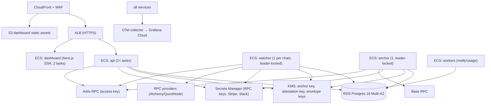

# L11 — Infrastructure, DevOps & Security Operations

| | |
|---|---|
| Lives in | `infra/` (Terraform, Docker, Compose, Helm later), `.github/workflows/`, `tools/` |
| Phase | P0 (CI, local stack), P3 (staging on AWS), P5 (prod), P7 (EU region, self-host Helm, SOC 2) |

---

## 1. Local development stack (`infra/compose/docker-compose.yml`)

| Service | Image | Purpose |
|---|---|---|
| `postgres` | postgres:16 | API, watcher, anchor, PostgresStore |
| `anvil-base` | ghcr.io/foundry-rs/foundry | local "Base" chain (chain id 31337 → configured as anchor chain) with `RecorderAnchor` + ERC-8004 mock registries deployed by `tools/local-chain/deploy.ts` |
| `anvil-agent` | foundry | the agent's watched chain (can be the same as anvil-base) |
| `localstack` | localstack/localstack | KMS for anchor/attestation signer tests |
| `mailpit` | axllent/mailpit | email capture |
| `api`, `anchor`, `watcher`, `dashboard` | built from repo (`pnpm dev` in watch mode) | |
| `demo-agent` | built | runs the demo scenario |

```
pnpm i
pnpm local:up          # compose up + deploy contracts + seed org/agent/keys (writes .env.local)
pnpm dev               # turbo dev for apps
pnpm e2e               # end-to-end demo scenario against the local stack
pnpm local:down
```

Arkiv locally: use `MemoryStore`/`PostgresStore` by default. If the Arkiv SDK's `localhost` chain matches a runnable local node image, add `arkiv-local` to Compose (P2 spike).

---

## 2. Cloud architecture (AWS)



- VPC: 3 AZs. Private subnets for tasks and RDS. NAT for egress. VPC endpoints for KMS/Secrets Manager/S3.
- Every service has its own IAM task role. Only `anchor` may `kms:Sign` the anchor key, and only `approvals`/`api` the attestation key.
- RDS: Multi-AZ, PITR 14 days, encrypted (KMS), IAM auth for services.
- Terraform modules: `network`, `rds`, `ecs-service`, `kms`, `cdn`, `observability`, `dns`. State in S3 + DynamoDB lock. Envs: `dev`, `staging`, `prod` as separate AWS accounts (AWS Organizations).
- Regions: `us-east-1` primary (P5). `eu-west-1` for EU control-plane data (P7). Arkiv/Base are global.
- P3-12: `infra/terraform/modules/{network,kms,rds,ecs-service}` and `envs/staging`. The runbook is `infra/terraform/README.md`, and both images are built from `infra/docker/service.Dockerfile` (`--build-arg APP=anchor|api`). Staging deviates from the target in three ways:
  - a single NAT gateway;
  - RDS is not Multi-AZ;
  - the API runs 2 tasks without Redis, so each task rate-limits on its own.

  The API container (`apps/api/src/main.ts`) migrates under an advisory lock, then listens on 8080. `GET /healthz` is the ALB's liveness check: it doesn't query the database (an RDS failover mustn't drain every task), isn't rate-limited, and isn't in the OpenAPI document.

  The anchor key policy denies `kms:Sign` to every principal except the anchor task role. Admins keep management rights only. EventBridge alerts fire on a foreign `Sign` or any key-policy change.

---

## 3. CI/CD (GitHub Actions)

| Workflow | Trigger | Jobs |
|---|---|---|
| `ci.yml` | PR, push | install (pnpm cache) → biome → typecheck → unit tests (vitest) → test-vectors check → dependency-cruiser layer rules → build → Foundry tests + gas snapshot → bench (hot path) with a regression gate (> 10 % fails) |
| `integration.yml` | PR (labels) + nightly | compose stack → store conformance (memory/pg) → proxy conformance with reference MCP servers → watcher Anvil E2E → dashboard Playwright |
| `testnet-e2e.yml` | nightly + manual | Arkiv Rabdi + Base Sepolia full demo scenario. Posts the report to Slack. Fails loudly |
| `security.yml` | PR + weekly | `pnpm audit` (high = fail), OSV scanner, Semgrep, gitleaks, Slither + Aderyn on contracts, CodeQL |
| `release.yml` | changeset merge to main | changesets version → npm publish with **provenance** (`--provenance`) for `@afr/core`, `@afr/verifier`, `@afr/cli`, `@afr/sdk`, `@afr/proxy` → Docker images to GHCR + ECR, **cosign-signed**, SBOM (syft) attached → CLI binaries attached to the GitHub release with checksums |
| `deploy.yml` | release tag | staging auto-deploy → smoke tests → manual approval → prod (ECS rolling, health-gated) |

Branch protection: required checks, 1 review (2 for `packages/core`, `packages/crypto`, `contracts/`), signed commits, CODEOWNERS on normative files.

**Supply chain** (we sell evidence, so we have to be clean): pinned dependency versions + lockfile, Renovate with a 7-day minimum release age, `npm provenance`, reproducible CLI builds (document the build env), SLSA level 3 target for the verifier release (P7).

---

## 4. Secrets and keys

| Secret | Store | Access |
|---|---|---|
| Anchor key | KMS asymmetric `ECC_SECG_P256K1` | anchor task role |
| Approval attestation key | KMS | approvals task role |
| Envelope keys (per-org data keys for channel configs, watch keys) | KMS symmetric | api, watcher |
| RPC/API tokens, Stripe, Slack, Telegram | Secrets Manager | per service |
| `RecorderAnchor` admin | Safe multisig 2-of-3 (founder hardware wallet, cofounder/advisor hardware wallet, cold backup) | humans |
| Arkiv writer keys (AFR-run services) | KMS (or Secrets Manager if the SDK needs a raw key; then rotate monthly) | anchor, api |
| Customer secrets | **never in AFR cloud** except watch keys (KMS-encrypted) | – |

**Key ceremony** for the anchor key and the admin Safe: documented runbook, two people, recorded in an internal AFR log entry (dogfooding the recorder).

---

## 5. Observability, SLOs and runbooks

### 5.1 SLOs

| SLO | Target | Alert |
|---|---|---|
| API availability | 99.9 % monthly | burn rate 2 %/1 h |
| Unlogged-tx alert latency (inclusion → notification) | p95 < 90 s | p95 > 120 s for 15 min |
| Anchor freshness | 99 % of active lanes anchored within 2× cadence | any lane > 3× |
| Watcher block lag | < 5 blocks | > 20 blocks for 5 min |
| Checkpoint ingestion | p95 < 5 s | – |
| Canary | 1 unlogged-tx alert/hour in staging and prod | missed canary → page (staging: alarms `afr-staging-canary-failed` and `-canary-missing` (no `canary_ok` for 2 h) → the `afr-staging-alerts` SNS topic) |

### 5.2 Runbooks (`infra/runbooks/*.md`, create during P5)

| Runbook | Trigger | Key steps |
|---|---|---|
| `arkiv-outage.md` | Arkiv RPC errors, store lag | Check status.arkiv.network. Recorders buffer automatically. Switch the dashboard to mirror reads. Comms template |
| `arkiv-rollback.md` | readback mismatch / missing entities | Freeze anchoring for affected lanes. Recorders re-create from the journal (same bytes). Verify equality. Post-mortem |
| `base-congestion.md` | anchor tx stuck | Fee bump replacement (same nonce). Cadence back-off. Status page |
| `anchor-key-compromise.md` | unexpected anchors from our key | Safe removes the recorder from the allowlist. Deploy a new key. Publish a notice listing affected epochs (junk roots don't validate anything real) |
| `watcher-lag.md` | block lag | Switch RPC provider. Scale. Backfill from the cursor |
| `false-positive-storm.md` | many UNLOGGED_TX at once | Check the recorder intent API / outbox health. Mass-suppress with reason `late_intent`. Fix root cause |
| `customer-key-compromise.md` | customer reports leaked agent key | Kill switch. Revoke the session key. Rotate the watch key. Evidence pack for their incident |
| `data-request.md` | GDPR/NDPA request | Control-plane data deletion. Explain crypto-shredding steps to the customer |

---

## 6. Threat model (full)

| # | Threat | Actor | Impact | Controls | Residual |
|---|---|---|---|---|---|
| T1 | Agent bypasses recorder for on-chain action | compromised agent / attacker with key | Funds moved without record | Watcher UNLOGGED_TX, kill switch | Detection ≤ 90 s, not prevention (prevention needs guardrails + smart-account policies) |
| T2 | Agent bypasses recorder for off-chain action (HTTP API, CEX) | same | Unrecorded action | Stated limit. LLM gateway + SDK reduce surface. Egress allowlists recommended | Accepted |
| T3 | Operator rewrites history | customer insider | False evidence | Readonly + lock + chain + anchors | None after anchor. ≤ cadence window before |
| T4 | Operator withholds records | customer insider | Incomplete evidence | Seq gaps, heartbeats, RECORDER_SILENT, watcher for on-chain | Off-chain withholding is detectable as silence, not content |
| T5 | Recorder host compromise | attacker | Forged records within the key window | Short TTL, scope, revocation, watcher, attested builds (P7: TEE option) | Window ≤ session TTL |
| T6 | Session key theft | attacker | Forged records / txs if the key also signs txs (it doesn't: session keys only sign records) | Session keys can't move funds. Revocation | Low |
| T7 | Prompt injection | content attacker | Harmful action | Guardrails, approvals, replay shows the injected input, inert rendering | Model-level risk remains |
| T8 | Dashboard XSS via logged content | content attacker | Steal reader key / decrypted data | Inert rendering, strict CSP, no innerHTML, Trusted Types | Low |
| T9 | AFR cloud compromise | external/insider | Drop alerts, stop anchoring, read metadata | No plaintext/keys in cloud. Anchor lag is publicly visible. Watch keys only reveal linkage | Metadata exposure |
| T10 | Arkiv rollback/censorship | network operator | Missing/reordered evidence | Base anchors, journal re-create, mirror, packs | Un-anchored window |
| T11 | Spam/forged entities with victim agent_key | anyone | Confuse indexers, cost | Signature filtering, writer filter, equivocation detection | Query cost |
| T12 | Equivocation by operator (two histories) | customer insider | Contradictory evidence | Detected by verifier/watcher (`EQUIVOCATION`) → critical, public | Detection only |
| T13 | Watch key leak | attacker | Link txs to agent at privacy 0 | Rotation, KMS | Linkage only |
| T14 | Reader key loss | customer | Can't read own history | Forced backup, multiple readers (operator + recovery reader) | Customer responsibility |
| T15 | Malicious MCP server response exploiting proxy parser | tool | RCE in recorder | Zod-validated JSON-RPC, size limits, fuzzing, no eval | Low |
| T16 | Supply-chain attack on `@afr/*` packages | attacker | Backdoored recorder/verifier | Provenance, signed images, 2-review on core, reproducible verifier | Low |
| T17 | Clock manipulation to backdate | operator | Misleading `ts` | Ordering by seq; time bounded by anchors; `ts` labelled informative | None |
| T18 | Permit/approval drain (signature-based theft) | attacker | Tokens leave without an agent tx | `msg_sign` recording, guardrails on permits, UNEXPLAINED_OUTFLOW | Detection after the fact |
| T19 | Approval spoofing in Slack | attacker in workspace | Fake human approval | Approver mapping, attested signature, eip712 required above threshold | Low |
| T20 | Denial of wallet (writer runs out of GLM) | ops | Store lag | Balance alerts at 7 days of runway, auto top-up job, multi-writer | Low |

**Security program:** threat-model review at each phase gate. External audit of `contracts/` (before mainnet) and a crypto review of L1/L4 (before v1 GA). Pentest of API/dashboard (before v1 GA). Bug bounty (Immunefi/HackerOne) after GA. `SECURITY.md` with a disclosure policy from day one.

---

## 7. Compliance programme

| Item | When |
|---|---|
| `SECURITY.md`, privacy policy, DPA template, subprocessors list | P5 |
| SOC 2 Type I (Vanta/Drata), with AFR's own audit logs recorded via AFR | P6 + 6 months |
| SOC 2 Type II | P7 |
| ISO 27001 (if enterprise demand) | P8 |
| Legal opinion: encrypted personal data on a public store + crypto-shredding (EU, Nigeria, Kenya, South Africa) | before EU enterprise sales |
| "Helps meet" compliance mapping whitepaper (AI Act Art. 12/19/26, DORA, MiCA) | P6 |

---

## 8. Self-hosting (P7)

- Helm chart `afr/afr` with values for each service and an external Postgres. KMS abstraction (AWS/GCP/Vault Transit).
- Docker Compose "single box" for small enterprises.
- Air-gapped mode: PostgresStore + customer-run anchor key on a private contract + periodic Base anchoring through an egress-only relay.
- License: the verifier/core/SDK are Apache-2.0. Dashboard/API/watcher self-host is under a commercial license.

---

## 9. Vibecoding prompts

1. "Create the monorepo skeleton per Architecture §16 with pnpm workspaces, Turborepo, Biome, Vitest, tsconfig base, changesets, and dependency-cruiser rules enforcing the layer dependency rule (Architecture §3)."
2. "Create `infra/compose/docker-compose.yml` per L11 §1 and `tools/local-chain/deploy.ts` that deploys RecorderAnchor and minimal mock ERC-8004 Identity/Validation registries to Anvil, seeds an org/agent via the API, and writes `.env.local`."
3. "Write `.github/workflows/ci.yml`, `integration.yml`, `security.yml` per L11 §3. Add a bench regression gate script."
4. "(P3) Write Terraform modules per L11 §2 for the `staging` account: network, rds, ecs-service (api, anchor, watcher, workers, dashboard), kms (anchor key ECC_SECG_P256K1), cdn, observability."
5. "(P5) Write all runbooks in L11 §5.2 as markdown checklists in `infra/runbooks/`."
