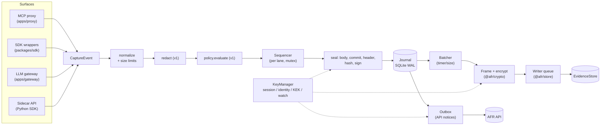
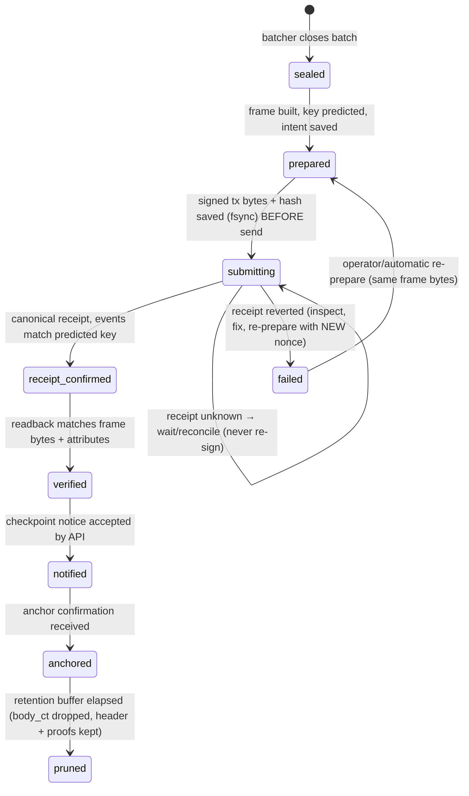

# L2 — Capture & Recorder (`@afr/recorder`, `fr-proxy`, `@afr/sdk`)

| | |
|---|---|
| Packages | `packages/recorder` (pipeline, journal, batcher, uploader, keys), `apps/proxy` (MCP proxy CLI/container), `packages/sdk` (public TS SDK), `apps/gateway` (LLM gateway, v1) |
| Depends on | `@afr/core`, `@afr/crypto`, `@afr/store`, `@afr/policy` (v1), `@modelcontextprotocol/sdk`, `viem`, `better-sqlite3`, `pino`, `yaml`, `zod` |
| Requirements | CAP-01…CAP-12, INT-04…INT-06, STO-01, STO-06, STO-07, PRV-01 |
| Phases | P1 (pipeline, journal, proxy, keys), P2 (batcher, uploader), P4 (intent outbox), P6 (gateway, Python sidecar, redaction, guardrail hooks) |

---

## 1. Responsibilities

1. **Capture** actions from three surfaces: MCP proxy, SDK wrappers (model, tool, wallet, message signing), LLM gateway.
2. **Sequence** them per (agent, lane): assign `seq`, `prev_hash`.
3. **Seal** them: body + salt + commitments, header, `record_hash`, signature.
4. **Journal** them durably before the action proceeds.
5. **Batch, encrypt, upload** them to the `EvidenceStore` asynchronously.
6. **Notify** the AFR API: checkpoints, tx intents, heartbeats.
7. **Manage keys**: session key, recorder identity key, epoch KEKs, watch key.
8. **Enforce guardrails** (v1) by calling `@afr/policy` on the hot path.

Never: block the agent except on guardrail approvals. Change any forwarded message. Log plaintext.

---

## 2. Internal architecture



### 2.1 Core types

```ts
// What every surface produces
interface CaptureEvent {
  type: ActionType;                 // from @afr/core
  at: number;                       // Date.now()
  refSeq?: bigint;
  model?: ModelInfo;
  tool?: ToolInfo;
  tx?: Omit<TxInfo, "data_commit">;
  approval?: ApprovalInfo;
  meta?: Record<string, string>;
  body: Partial<Pick<RecordBodyV1, "args" | "result" | "context" | "output" | "calldata">>;
}

interface SealedRecord {
  seq: bigint;
  header: RecordHeaderV1;
  body: RecordBodyV1;
  hash: Hex;
  sig: Hex;
  sessionKey: Hex;
}

interface Recorder {
  capture(ev: CaptureEvent): SealedRecord;          // synchronous: seals + journals. Throws only in fail-closed mode
  decide(ev: CaptureEvent): Promise<Decision>;      // v1: policy + approvals (may block)
  flush(): Promise<void>;                           // force batch close + upload
  close(reason?: string): Promise<void>;            // session_end + flush
  status(): RecorderStatus;
  readonly agentId: string; readonly lane: number;
}
```

`capture()` is **synchronous** on purpose. JCS, keccak, noble secp256k1 signing and better-sqlite3 inserts are all synchronous, which gives deterministic ordering and avoids race conditions in seq assignment. Signing uses `@noble/curves` `secp256k1.sign` directly (sync), not viem's async account API.

---

## 3. Sequencer and sealing

```
capture(ev):
  assert state == RUNNING (else: fail-open → buffer to "pending_gap" counter; fail-closed → throw)
  ev = normalize(ev)                          // §3.1
  ev = redact(ev)                             // v1, §8
  lock(lane):
    seq   = state.nextSeq
    prev  = state.prevHash
    salt  = rng(32)
    body  = buildBody(ev.body, salt, {maxBytes})
    hdr   = buildHeader({...ev, commit: commitmentsFor(body), session_id}, {seq, prevHash: prev})
    hash  = hashHeader(hdr)
    sig   = sessionKey.signSync(hash)
    journal.insertRecord(seq, hdr, encryptAtRest(body), hash, sig)   // single SQLite txn
    state.nextSeq++, state.prevHash = hash
  emit("sealed", rec)                         // batcher, intent outbox
  return rec
```

### 3.1 Normalisation rules

- Strings: NFC. Addresses: lowercase. Numbers in `tx`: decimal strings. Bigint → string.
- Tool args/results: kept as JSON values. Binary MCP content (`image`, `audio` base64) is **replaced** by `{ "type": "...", "sha256": "...", "bytes": n }` unless `capture.binary: full`.
- Body part > `max_body_bytes`: truncate per L1 §3.3 (the commitment covers the full value).
- `meta` keys/values are trimmed to limits. Overflow is dropped and noted as `meta.truncated = "1"`.

### 3.2 Gap handling

If records can't be journaled (disk full, journal corruption) in fail-open mode, the recorder **reserves** the seq numbers it would have used (`gapStart..gapEnd`) without signing. Once healthy again, it emits a `gap` record covering them. The chain stays continuous: the `gap` record has `seq = gapEnd + 1`, `meta.from_seq = gapStart`, `meta.to_seq = gapEnd`, and `prev_hash` = the last good hash. Verifiers accept exactly that shape (finding `GAP`, info) and report any other seq jump as `SEQ_GAP`. The gap is visible and signed.

---

## 4. Journal (SQLite)

File: `${dataDir}/journal.sqlite` (default `~/.afr/<agent-key-short>/lane-<n>/`), mode 0600.

```sql
PRAGMA journal_mode = WAL;
PRAGMA synchronous = NORMAL;      -- fsync at WAL checkpoint; set FULL with `durability: strict`
PRAGMA foreign_keys = ON;

CREATE TABLE meta (k TEXT PRIMARY KEY, v TEXT NOT NULL);
-- keys: schema_version, agent_id, lane, created_at (+ chain_root, last_batch_seq_to from P2).
-- next_seq / prev_hash are derived from the last `records` row, the single source of truth.

CREATE TABLE session_keys (
  address TEXT PRIMARY KEY, session_id TEXT NOT NULL,
  delegation_json TEXT NOT NULL, delegation_sig TEXT NOT NULL,
  parent_json TEXT, parent_sig TEXT,                -- sub-delegation chain (L1 §7.1)
  not_before INTEGER NOT NULL, not_after INTEGER NOT NULL,
  published_entity TEXT,                            -- arkiv key once afr.delegation.v1 is stored
  created_at INTEGER NOT NULL
);

CREATE TABLE records (
  seq INTEGER PRIMARY KEY,                          -- uint64 fits in SQLite INTEGER (signed 64) for 9e18
  type TEXT NOT NULL,
  header_jcs TEXT NOT NULL,
  body_ct BLOB NOT NULL,                            -- iv(12) ‖ AES-256-GCM(journal_key, utf8(JSON(body)), aad = "AFR_JOURNAL_V1" ‖ u64be(seq) ‖ hash)
  hash TEXT NOT NULL UNIQUE,
  sig TEXT NOT NULL,
  session_key TEXT NOT NULL REFERENCES session_keys(address),
  batch_seq_from INTEGER,                           -- NULL until assigned to a batch
  created_at INTEGER NOT NULL
);

CREATE TABLE batches (
  seq_from INTEGER PRIMARY KEY,
  seq_to INTEGER NOT NULL,
  state TEXT NOT NULL CHECK (state IN
    ('sealed','prepared','submitting','receipt_confirmed','verified','notified','anchored','pruned','failed')),
  frame BLOB NOT NULL,                              -- exact bytes uploaded (deterministic)
  batch_root TEXT NOT NULL, prev_chain_root TEXT NOT NULL, chain_root TEXT NOT NULL,
  predicted_key TEXT, entity_key TEXT, tx_hash TEXT, signed_tx BLOB, writer_nonce INTEGER,
  attempts INTEGER NOT NULL DEFAULT 0, last_error TEXT,
  anchor_tx TEXT, anchored_at INTEGER,
  created_at INTEGER NOT NULL, updated_at INTEGER NOT NULL
);

CREATE TABLE outbox (
  id INTEGER PRIMARY KEY AUTOINCREMENT,
  kind TEXT NOT NULL CHECK (kind IN ('checkpoint','tx_intent','heartbeat','delegation','status')),
  payload TEXT NOT NULL, attempts INTEGER NOT NULL DEFAULT 0,
  next_attempt_at INTEGER NOT NULL, created_at INTEGER NOT NULL
);

CREATE TABLE epochs (
  epoch_id INTEGER PRIMARY KEY, kek_id TEXT NOT NULL,
  kek_sealed BLOB NOT NULL,                         -- KEK sealed by KeyStore (KMS/OS keystore/passphrase)
  readers_json TEXT NOT NULL, grants_published INTEGER NOT NULL DEFAULT 0,
  created_at INTEGER NOT NULL, rotated_at INTEGER
);
```

**Batch state machine** (follows the Arkiv write-safety guidance):



**Pruning:** after `anchored + journal.retain_days` (default 30), `records.body_ct` and `batches.frame` are deleted, and headers, hashes and roots stay. Optional archive to the customer's S3/GCS before pruning (`archive.target`), so the customer keeps an offline copy independent of Arkiv.

**Journal key:** AES-256 key sealed by `KeyStore`: AWS KMS, GCP KMS, OS keychain (`keytar`), or a passphrase file (scrypt). In dev mode a plaintext key file is allowed, with a warning.

---

## 5. MCP proxy (`fr-proxy`)

### 5.1 Modes

| Downstream (agent-facing) | Upstream (tool-facing) | Use |
|---|---|---|
| stdio | stdio (spawned child) | Claude Desktop / Claude Code / IDE agents: replace the server command with `fr-proxy --upstream "<cmd>"` |
| Streamable HTTP (`/mcp`) | Streamable HTTP | Remote MCP servers, containerised agents |
| stdio | Streamable HTTP | Local agent, remote tools |
| Streamable HTTP | stdio | Shared proxy in front of local tools |

Multi-upstream (P6): one downstream endpoint, many upstreams. Tools are namespaced `server__tool` in `tools/list` (rewriting is opt-in: `namespacing: true`. When it's off, names must not collide).

### 5.2 Message handling

The proxy works at the **JSON-RPC message level** using the SDK's transports (`StdioServerTransport`, `StdioClientTransport`, `StreamableHTTPServerTransport`, `StreamableHTTPClientTransport`). It does **not** use the high-level `Server`/`Client` classes. Messages are forwarded as the same JSON value (parsed `JSONRPCMessage` objects re-serialised by the transport), so the JSON is identical, but whitespace and key order may differ from the original bytes. This is what PRD CAP-01 "unchanged" means.

```
downstream.onmessage(msg):
  if isRequest(msg) && msg.method == "tools/call":
     pending[msg.id] = { seq: capture(tool_call{server, name, args}), started: now }
     if guardrails: decision = await decide(...); if deny → reply JSON-RPC result {isError:true, content:[{type:"text", text: "Blocked by policy <rule>"}]} and capture(policy_block); return
  upstream.send(msg)                                    // unchanged
upstream.onmessage(msg):
  if isResponse(msg) && pending[msg.id]:
     capture(tool_result{ref_seq, is_error: msg.error != null || msg.result?.isError, duration_ms, result: msg.result ?? {error: msg.error}})
     delete pending[msg.id]
  downstream.send(msg)                                  // unchanged
both directions: notifications (progress, cancelled, list_changed), server→client requests (sampling/createMessage, elicitation/create, roots/list) pass through untouched.
cancel: notifications/cancelled for a pending id → capture(tool_result{ref_seq, is_error:true, meta.cancelled:"1"})
on upstream close: every pending call → tool_result{is_error:true, meta.reason:"upstream_closed"}
```

- `initialize` is passed through. `session_start` is written by the recorder at startup (before any client connects), so the proxy records the handshake as a `note` with `meta.event = "mcp_initialize"`, `meta.mcp_client = clientInfo.name/version`, `meta.mcp_protocol`, and the client info in `body.args`.
- HTTP: forward `Mcp-Session-Id`. Forward `Authorization` to upstream only if `upstream.forward_auth: true`. Otherwise use the configured upstream credentials (OAuth client per MCP auth spec, P6).
- Bind address default `127.0.0.1`. Non-local bind requires `auth.token` (bearer) or mTLS.
- `sampling/createMessage` from server → client is the server asking the agent's model. It's recorded as `model_call` with `meta.via = "mcp_sampling"` (P6).

### 5.3 CLI

```
fr-proxy init                         # interactive: agent id, lane, store, privacy, writes afr.config.yaml
fr-proxy run [--config afr.config.yaml]
fr-proxy run --upstream "npx -y @modelcontextprotocol/server-filesystem /data"   # quick stdio wrap
fr-proxy run --upstream-url https://tools.example.com/mcp --listen 127.0.0.1:7801
fr-proxy sidecar --socket /tmp/afr.sock   # capture API for Python SDK / other languages (P6)
fr-proxy status                       # seq, lag, pending batches, key expiry
fr-proxy delegate                     # (re)run delegation flow
fr-proxy flush
```

Claude Code / Claude Desktop example:

```json
{
  "mcpServers": {
    "uniswap": {
      "command": "npx",
      "args": ["-y", "@afr/proxy", "run", "--config", "/etc/afr/agent.yaml", "--upstream", "node /opt/uniswap-mcp/index.js"]
    }
  }
}
```

---

## 6. TypeScript SDK (`@afr/sdk`)

```ts
import { createRecorder } from "@afr/sdk";

const afr = await createRecorder({ config: "./afr.config.yaml" });  // or inline config object

// 1. Wallet (viem). Wraps the account so EVERY signing path is recorded (sendTransaction, writeContract, deployContract, signTransaction)
const wallet = afr.wrapWalletClient(createWalletClient({ account, chain: base, transport: http() }));

// 2. Models
const anthropic = afr.wrapAnthropic(new Anthropic());      // messages.create / stream
const openai    = afr.wrapOpenAI(new OpenAI());            // chat.completions / responses
const model     = afr.aiSdkModel(anthropicProvider("claude-opus-5-5"));   // Vercel AI SDK wrapLanguageModel middleware

// 3. Tools (non-MCP)
const getPrice = afr.wrapTool("price.get", async (sym: string) => fetchPrice(sym));

// 4. Framework adapters (P5/P6)
const hooks = afr.claudeAgentSdkHooks();                   // PreToolUse/PostToolUse hooks for Claude Agent SDK
const cb    = afr.langchainCallback();                      // via sidecar in Python

// 5. Manual
afr.note("operator declared incident #12", { incident: "12" });
await afr.close("shutdown");
```

### 6.1 Wallet hook design

- Wrap the **account** with viem's `toAccount({ address, signTransaction, signMessage, signTypedData })`, delegating to the original:
  - `signTransaction(tx)`: serialise → sign → compute `txHash = keccak256(signedSerialized)` → `capture(tx_sign{chain_id, from, to, nonce, value, tx_hash, selector?}, body{args: tx (sans data), calldata: tx.data})` → return signed.
  - `signMessage` / `signTypedData`: `capture(msg_sign{...})` **before** signing.
- Wrap the **transport** (`custom` transport proxying the original) to observe `eth_sendRawTransaction` → `capture(tx_broadcast{tx_hash, status, ref_seq})`.
- JSON-RPC (node-managed / remote signer) accounts can't produce a pre-broadcast hash. Intercept `eth_sendTransaction`: fetch the pending nonce if absent, then capture `tx_sign` with `tx_hash` omitted and a nonce commitment, broadcast, and capture `tx_broadcast` with the hash.
- Smart accounts (P6): wrap `bundlerClient.sendUserOperation` and record `userOpHash` (`kind: "userop"`). The watcher matches on `UserOperationEvent`.
- Every `tx_sign` enqueues a **tx intent** in the outbox: `{agent_key, lane, seq, tx_commit: HMAC(watch_key, AFR_TX_V1‖chainId‖txHash), nonce_commit}`. It gets sent within ~1 s (best effort), well before the 60 s watcher grace.

### 6.2 Model wrapper design

- Record a `model_call` **after** the response (one record): `model{provider, id, version: response.model, tokens}`, `body.context = {system, messages, tools, params}` per `capture.context` mode, `body.output = response.content`. Streaming: assemble the final message, then capture.
- Context capture modes: `full` (default for dev), `hash_only` (body omits context, commit over the full value; marked truncated), `last_turn` (only the latest user/tool messages + system hash).
- Errors: capture `model_call` with `meta.error = <class>`.

---

## 7. Key management (`KeyManager`)

| Key | Generated | Stored | Published |
|---|---|---|---|
| Session key | On every start and every `session_ttl` (≤ 24 h) | Memory only | `afr.delegation.v1` (+ parent) |
| Recorder identity key (optional) | `fr keys identity` | KMS / encrypted keystore | parent delegation |
| Writer key (Arkiv gas) | `fr keys writer` / config | env/KMS | – |
| Journal key | First start | `KeyStore` | – |
| Epoch KEK | Monthly + on demand | sealed in `epochs` | `afr.keygrant.v1` per reader |
| Watch key | Provisioned by API on agent creation (or `fr keys watch`) | `KeyStore` | – (shared with hosted watcher via API, KMS-encrypted) |

### 7.1 Delegation flows (`delegation.mode`)

| Mode | How | Use |
|---|---|---|
| `operator_env` | `AFR_OPERATOR_KEY` in env signs directly | local/dev/demo only |
| `kms` | Operator key in AWS/GCP KMS (secp256k1). Recorder calls Sign | production automation |
| `identity_key` | Operator signed a 30-day delegation for the recorder identity key (once, through the dashboard/CLI). The recorder signs 24 h session delegations itself | production default |
| `interactive` | Recorder prints EIP-712 JSON + QR/WalletConnect URI (or dashboard push). It waits up to `delegation.timeout` and buffers records meanwhile, signed by the session key and published once the delegation arrives | first-time setup |

**Rotation:** at `notAfter − 10 min` the recorder creates a new session key + delegation, emits `session_end{reason:"rotate"}` with the old key, then `session_start` with the new one. The chain continues. The identity key expiring triggers a dashboard notification 7 days ahead.

### 7.2 Startup sequence

```
1 load config, validate (zod)
2 open journal; if meta.agent_id ≠ config.agent_id → refuse (prevent cross-agent chain mixing)
3 recover: next_seq, prev_hash, chain_root from meta; verify last 100 records' chain locally
4 resume batches in non-terminal states (reconcile, never re-sign)
5 load/unseal epoch KEK (rotate if month changed)
6 create session key → obtain delegation (mode) → queue afr.delegation.v1 publish
7 capture(session_start{recorder_version, config_hash, delegation_hash, session_key, recovered_from_seq?, clock_skew_ms?})
8 start batcher, uploader, outbox, heartbeat timers; start surfaces
```

---

## 8. Redaction (v1)

```yaml
redact:
  - path: "$.args.apiKey"          # JSONPath over body parts
  - path: "$..password"
  - pattern: "sk-[A-Za-z0-9]{20,}" # regex over all strings
    replace: "[REDACTED:openai-key]"
  - tool: "email.read"
    path: "$.result.content[*].text"
    mode: hash                     # replace with sha256, keep length
```

Redaction runs **before** commitment, so redacted secrets never exist in evidence. A secret-scanner preset (`redact_presets: [secrets]`) covers common key formats.

---

## 9. Batcher and uploader

- **Close triggers:** age ≥ `batch.max_age_ms` (5 s) **or** estimated frame size ≥ `batch.target_bytes` (96 KiB) **or** record count ≥ 1,000 **or** explicit `flush()`/`close()`. At privacy 0 with `heartbeat: true`, when nothing happened for `heartbeat_ms` the recorder captures a `note` record with `meta.event = "heartbeat"` and closes a one-record batch. Batches are never empty.
- **Size estimation:** keep a running compressed-size estimate. If the final frame exceeds `BATCH_MAX_FRAME_BYTES`, split at the midpoint and retry (recursive). A single record > max frame (pathological) gets its body truncated harder, and the event is noted.
- **Upload:** one writer queue per writer account (L3 §7). Ordering: batch N+1 may be **prepared** while N is in flight, but **submitted** only after N reaches `receipt_confirmed` (nonce ordering and chain-root ordering).
- **Backpressure:** if pending batches exceed `max_pending_bytes` (default 1 GiB), log a warning and raise the `afr_store_lag_seconds` alert. The agent is never blocked.
- **Delegations first:** a batch is never submitted before the delegation entity for every session key in it is `verified`.

---

## 10. Outbox → API

| Notice | When | Payload |
|---|---|---|
| `tx_intent` | each `tx_sign` / `msg_sign` | `{agent_key, lane, seq, tx_commit?, nonce_commit, chain_id}` (no plaintext) |
| `checkpoint` | batch `verified` | `{agent_key, lane, seq_from, seq_to, batch_root, chain_root, entity_key, arkiv_tx}` |
| `heartbeat` | every 30 s | `{agent_key, lane, next_seq, pending_batches, store_lag_s, key_not_after, version}` |
| `delegation` | delegation published | `{session_key, not_before, not_after, entity_key}` |

Delivery: HTTPS POST with `Authorization: Bearer <recorder api key>` and an `X-AFR-Signature` HMAC of the body. Retries use exponential backoff for up to 7 days, and the notices are idempotent by (kind, agent, lane, seq).

---

## 11. Configuration (`afr.config.yaml`)

```yaml
version: 1
agent:
  id: "eip155:8453:0xregistry...:42"
  lane: 0
  privacy_level: 0            # 0 sealed | 1 flags | 2 open
  retention_days: 365
data_dir: "~/.afr"
durability: normal            # normal | strict (synchronous=FULL)
fail_mode: open               # open | closed (closed only meaningful with guardrails)

store:
  kind: arkiv                 # arkiv | postgres | memory
  arkiv:
    chain: rabdi
    access_key_env: ARKIV_ACCESS_KEY
    writer_key_env: AFR_ARKIV_WRITER_KEY
    evidence_lock: true
    expiry: rolling           # rolling (default; required when retention_days > 30) | upfront (≤ 30 d only), L3 §6
  postgres:
    url_env: AFR_STORE_PG_URL
  mirror: postgres            # optional second store written after primary (dual-write)

delegation:
  mode: identity_key          # operator_env | kms | identity_key | interactive
  session_ttl_s: 86400
  kms: { provider: aws, key_id: "arn:aws:kms:..." }
  identity_keystore: "~/.afr/identity.json"

keystore:
  kind: aws-kms               # aws-kms | gcp-kms | os | passphrase | dev-plaintext
  key_id: "arn:aws:kms:..."

encryption:
  readers:                    # x25519 public keys (operator default + auditors); synced from API when api.sync_readers
    - "0x…"
  epoch: monthly

capture:
  context: full               # full | hash_only | last_turn
  max_body_bytes: 65536
  binary: hash                # hash | full

batch:
  max_age_ms: 5000
  target_bytes: 98304
  heartbeat: true
  heartbeat_ms: 60000
  padding: true               # pad to PADDING_BUCKETS at privacy 0

api:
  url: "https://api.afr.dev"
  key_env: AFR_API_KEY
  sync_readers: true

proxy:
  listen: "stdio"             # stdio | "127.0.0.1:7801"
  auth_token_env: AFR_PROXY_TOKEN   # bearer token HTTP clients must send; required for non-loopback listen
  upstreams:
    - name: uniswap
      command: "node /opt/uniswap-mcp/index.js"
    - name: search
      url: "https://search.example.com/mcp"
      forward_auth: false

redact: []
policy:                       # v1 (L10)
  file: "./policy.yaml"

journal:
  retain_days: 30
  max_bytes: 10737418240
archive:
  target: "s3://customer-bucket/afr/"   # optional

telemetry:
  prometheus: "127.0.0.1:9464"
  otlp_endpoint: null
```

Env vars override every value (`AFR_AGENT_ID`, `AFR_STORE_KIND`, …). The config hash is `keccak(JCS(config without secrets))`, recorded in `session_start`.

---

## 12. Python SDK via sidecar (v1)

```python
from afr import Recorder
afr = Recorder(socket="/tmp/afr.sock")          # talks to `fr-proxy sidecar`
w3 = afr.wrap_web3(w3)                          # signs via local account middleware → tx_sign before send
client = afr.wrap_anthropic(anthropic.Anthropic())
@afr.tool("price.get")
def get_price(sym): ...
handler = afr.langchain_handler()               # BaseCallbackHandler: on_tool_start/end, on_llm_end
```

Sidecar API (unix socket, JSON lines): `{"op":"capture","event":{...}}` → `{"seq":"12","hash":"0x…"}`. Plus `{"op":"decide",...}` (guardrails), `flush`, `status`. Python never handles keys or crypto.

---

## 13. LLM gateway (v1)

`apps/gateway` is an HTTP server that speaks the Anthropic Messages API and OpenAI Chat/Responses APIs. You point `ANTHROPIC_BASE_URL` / `OPENAI_BASE_URL` at it. It forwards to the real provider with the agent's own API key (pass-through header) and records `model_call` per request. Streaming is passed through chunk by chunk with the full output assembled for the record. This captures model calls with zero code changes.

---

## 14. Errors and degradation

| Condition | Behavior |
|---|---|
| Journal write fails | fail-open: reserve seq, increment gap counter, log critical, metric. Retry every 5 s. Emit `gap` when healthy |
| Signing key unavailable (delegation pending) | Records are signed by the session key (always available). Publishing waits |
| Upstream MCP server crash | pending calls → `tool_result` errors. The proxy relays the transport error to the agent as upstream would |
| Policy engine throws | fail-open → `decision: allow`, `meta.policy_error`. Fail-closed → deny |
| Store unavailable | batches accumulate. Never blocks |
| Clock jump backwards | `ts` may decrease, which is allowed (informative). Logged |

---

## 15. Tests and acceptance criteria

| # | Test | Acceptance |
|---|---|---|
| R1 | Sequencer: 10k concurrent `capture()` calls (async callers) → seq contiguous, chain valid | ✅ |
| R2 | Crash safety: kill -9 at random points during 1k actions. Restart → no lost journaled record, chain valid, no duplicate seq | 100 runs |
| R3 | Proxy conformance: run the MCP "everything" reference server + filesystem server through the proxy. Every response deep-equals the direct response | ✅ |
| R4 | Proxy passes notifications, cancellation, sampling, elicitation both ways | ✅ |
| R5 | Hot path p99 ≤ 5 ms with policy off, ≤ 6 ms with a 50-rule policy (CI runner, 2 KiB args) | bench |
| R6 | Wallet hook on Anvil: `sendTransaction`, `writeContract`, `deployContract`, `signTypedData` all produce records. `tx_hash` in `tx_sign` == mined hash | ✅ |
| R7 | Batcher never produces a frame > 120 KiB across fuzzed record sizes | property |
| R8 | Write state machine: inject lost send response / receipt timeout / revert. No double create, no re-sign | ✅ |
| R9 | Redaction: redacted values absent from journal, frame and commitments | ✅ |
| R10 | Logs contain no body content (grep test over captured pino output with canary strings) | ✅ |
| R11 | Session rotation keeps chain continuity and the delegation is published before any batch using the key | ✅ |

---

## 16. Vibecoding prompts

1. "Create `packages/recorder` with modules: `config.ts` (zod schema from L2 §11), `journal.ts` (SQLite schema from L2 §4, better-sqlite3, WAL), `keys.ts` (KeyManager with dev-plaintext keystore only), `sequencer.ts` (synchronous `capture()` per L2 §3 using @afr/core). Write tests R1 and R2 (use child_process + SIGKILL for R2)."
2. "Implement the batch state machine in `batcher.ts` and `uploader.ts` exactly as the L2 §4 diagram. Use an injected `EvidenceStore` (from @afr/store, use MemoryStore in tests). Implement failure injection hooks for R8."
3. "Create `apps/proxy` using `@modelcontextprotocol/sdk` transports only (no high-level Server/Client). Implement the message-handling pseudocode in L2 §5.2 for stdio↔stdio first. Add R3/R4 tests against `@modelcontextprotocol/server-everything`."
4. "Add Streamable HTTP downstream and upstream to the proxy, with bind-address/auth rules from L2 §5.2, and the CLI in L2 §5.3 (commander)."
5. "Create `packages/sdk` with `createRecorder`, `wrapWalletClient` (account wrapping via viem `toAccount` + custom transport, L2 §6.1), and `wrapAnthropic` (L2 §6.2). Test R6 against Anvil (`prool` or `@viem/anvil`)."
6. "Implement the outbox (L2 §10) with HMAC request signing and exponential backoff. Unit-test idempotency."
7. "Implement delegation modes `operator_env` and `interactive` (print EIP-712 JSON; accept signature via `fr-proxy delegate --sig`). Implement rotation (L2 §7.1) and test R11."
