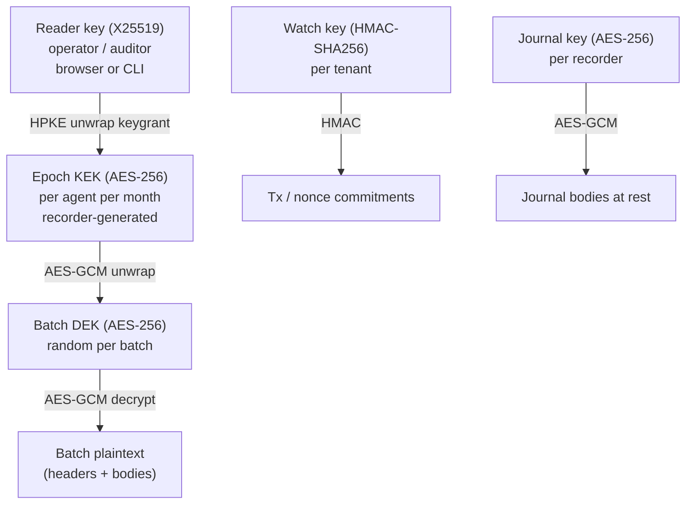

# L4 — Encryption & Access Control (`@afr/crypto`)

> **Format v1-rc (frozen 2026-11-05, ADR-025).** The byte formats in §3–§6 (batch encryption, DEK wrapping, HPKE keygrants, reader keys) are frozen. The external cryptography review (ADR-009) still gates v1 GA. From here on, any change to them needs an ADR in `docs/01-architecture/ADRS.md` and regenerated `packages/test-vectors`. Editorial fixes that change no bytes or behaviour don't.

> **[NORMATIVE]** for byte formats (§3–§6). Needs an external cryptography review before v1 GA (ADR-009).

| | |
|---|---|
| Package | `packages/crypto` → `@afr/crypto` (isomorphic: Node ≥ 22 + modern browsers) |
| Depends on | `@afr/core`, `@noble/ciphers` (AES-GCM fallback), WebCrypto, `@hpke/core` + `@hpke/dhkem-x25519` (RFC 9180), `@noble/curves` (x25519 fallback), `@noble/hashes` (HMAC, HKDF), `hash-wasm` (Argon2id for passphrase backups) |
| Used by | recorder (encrypt, wrap, grant), dashboard (unwrap, decrypt, grant), CLI/verifier (decrypt), watcher (HMAC) |
| Requirements | PRV-01…PRV-08, WAT-06 |
| Phase | P2 (DEK/KEK/HPKE, operator reader), P6 (auditor grants, revocation, shredding, selective disclosure) |

---

## 1. Goals

1. Our servers and the public never see plaintext. Only key holders do.
2. Ciphertext is bound to its batch, so an envelope can't be replayed into a different batch, agent or position.
3. Granting a reader access to history is cheap: one grant per epoch, not per batch.
4. Revocation (forward) and crypto-shredding (erasure) are possible.
5. The hosted watcher can match transactions without content access.

## 2. Key hierarchy



| Key | Generator | Lifetime | Who holds it |
|---|---|---|---|
| Reader key (X25519) | Reader's browser/CLI | ≤ 2 years (statement `notAfter`) | Reader only (+ their encrypted backup) |
| Epoch KEK | Recorder | 1 month (or until early rotation) | Recorder (sealed), and readers via keygrants |
| Batch DEK | Recorder | one batch | nobody after encryption (wrapped in the frame) |
| Watch key | API (on agent create) | 1 year | Recorder + hosted watcher (KMS-encrypted) |
| Journal key | Recorder | recorder lifetime | Recorder KeyStore |

## 3. Batch encryption [NORMATIVE]

```
batch_aad = keccak256( abi.encode(
    string  "AFR_BATCH_AAD_V1",
    bytes32 agent_key,
    uint32  lane,
    uint64  seq_from,
    uint64  seq_to,
    bytes32 batch_root,
    uint32  epoch_id,
    bytes32 kek_id ) )                                   // 32 bytes

DEK  = random(32)
iv   = random(12)                                        // stored in pub.iv
ct   = AES-256-GCM-Encrypt(key=DEK, iv, plaintext=padded_plaintext, aad=batch_aad)   // ct ‖ tag(16)
payload_ct_hash = keccak256(ct)
```

`padded_plaintext` is defined in L3 §4. The DEK is used once, so random IVs are safe.

## 4. DEK wrapping [NORMATIVE]

```
kek_id   = keccak256( "AFR_KEK_ID_V1" ‖ agent_key ‖ u32be(epoch_id) ‖ HMAC-SHA256(KEK, "AFR_KEK_ID_V1") )
dek_aad  = utf8("AFR_DEK_V1") ‖ agent_key(32) ‖ u32be(epoch_id) ‖ batch_aad(32)
wiv      = random(12)
wrapped_dek = wiv ‖ AES-256-GCM-Encrypt(key=KEK, iv=wiv, plaintext=DEK, aad=dek_aad)     // 12 + 32 + 16 = 60 bytes
```

**IV budget:** each KEK wraps at most 2^20 DEKs (far below the 2^32 limit for random 96-bit IVs). The recorder rotates early when the count is reached.

## 5. Keygrants (HPKE) [NORMATIVE]

```
suite    = HPKE base mode, KEM = DHKEM(X25519, HKDF-SHA256) (0x0020), KDF = HKDF-SHA256 (0x0001), AEAD = AES-256-GCM (0x0002)
info     = utf8("AFR_KEYGRANT_V1") ‖ agent_key(32) ‖ u32be(epoch_id)
aad      = kek_id(32)
(enc, ct)= HPKE.Seal(pkR = reader_x25519, info, aad, plaintext = KEK)       // enc 32 B, ct 48 B
```

Stored as an `afr.keygrant.v1` entity (L3 §5):

```
grant = CBOR({ enc, ct, statement: KeyGrant{agentKey, epochId, kekId, reader, encHash = keccak(enc‖ct)}, sig })
```

- `sig`: EIP-712 `KeyGrant` signed by the operator (dashboard grants) **or** by a session key with scope bit 4 (automatic recorder grants for configured readers).
- **Flags:** readonly, **not locked**, **no permissionless extension.** The writer can delete it for crypto-shredding (§8).
- Recorder behaviour: when an epoch starts, generate the KEK and publish one keygrant per reader in `encryption.readers`, **before** the first batch of that epoch is submitted. The uploader is gated per batch on `epochs.grants_published` of its `epoch_id`; without an HPKE sealer, configured readers hold uploads back (`KEYGRANT_UNAVAILABLE`, the agent is never blocked). One keygrant entity per (agent, epoch, reader): idempotency key `keccak(abi.encode("afr.keygrant", agent_key, epoch_id, reader))`. The KEK is stored sealed under the journal key, AAD = kek_id (`epochs.kek_sealed`).

## 6. Reader keys [NORMATIVE]

```
ReaderKey EIP-712 { owner: address, x25519: bytes32, label: string, notAfter: uint64 }   (domain chainId 8453)
```

- Generated in the browser: WebCrypto `X25519` where available (non-extractable private key in IndexedDB), else `@noble/curves` x25519 kept only inside an encrypted backup.
- **Backup file** `.afrkey` (JSON): `{ v:1, x25519_pub, kdf:"argon2id", m:65536, t:3, p:1, salt, iv, ct }`. `ct` = AES-GCM(Argon2id(passphrase), secret), no AAD; `secret` is the raw 32-byte X25519 private key, and import checks that it opens a seal to `x25519_pub`. Users must download it on creation (UI forces acknowledgement). Argon2id comes from `@noble/hashes` (already a dependency) rather than `hash-wasm`. Import bounds the cost parameters (`m` ≤ 1 GiB, `t` ≤ 10, `p` ≤ 4), so a crafted file can't stall a reader.
- CLI: `fr keys reader new --out auditor.afrkey`, `fr keys reader import`. Until then, `tools/scripts/decrypt-agent.ts keygen --out <file>` creates one (P2-16).
- Published as `afr.readerkey.v1` (optional, so auditors can be discovered) and registered with the API.
- **Not** derived from wallet signatures. Signature-derived keys can be phished by tricking a user into signing the derivation message.

## 7. Grant, revoke, rotate (v1 flows)

### 7.1 Forward grant (add reader)

1. The operator adds the auditor reader key in the dashboard (it must carry a valid `ReaderKey` signature from the auditor's wallet).
2. The API updates the agent's reader set and bumps the `AgentProfile.version` (operator signs).
3. The recorder syncs readers (`api.sync_readers`) and publishes a keygrant for the **current** epoch to the new reader. Future epochs include them automatically.

### 7.2 Historic grant (range)

1. The operator chooses `[from, to]` in the dashboard. The browser determines the epochs covering that range.
2. For each epoch: fetch the operator's keygrant → HPKE-open with the operator reader key → KEK → HPKE-seal to the auditor → sign `KeyGrant` with the operator wallet → publish.
3. **Granularity is per epoch.** Finer scope (a single day within a month) needs **selective disclosure** (§9) instead of key sharing. The UI shows exactly which period becomes readable.

### 7.3 Revocation

- Remove the reader → the recorder **rotates the epoch immediately** (`rotation += 1`) and doesn't grant the new KEK to the removed reader.
- **The revoked reader keeps access to everything already granted.** The UI states this plainly.

### 7.4 Rotation triggers

Month boundary (UTC), reader removed, 2^20 DEK wraps (the recorder rotates 4,096 wraps early, since one seal may wrap many DEKs), suspected KEK compromise (manual `fr keys rotate-epoch`). A rotation within the month is `rotation += 1` (≤ 15, `epochIdFor`); already-sealed batches keep their epoch.

## 8. Crypto-shredding (erasure, v1)

Goal: make an epoch unreadable for everyone who hasn't already extracted its KEK.

1. Delete the epoch's KEK from the recorder journal (`epochs.kek_sealed`) and any archive copies.
2. Delete the epoch's keygrant entities on Arkiv (they're unlocked and owned by the writer), and any Postgres mirror rows.
3. Record a `note` record with `meta.event = "shredded"` and `meta.epoch_id`. That way the erasure itself is evidence.

**Stated limits:** anyone who previously saved a keygrant **and** holds a granted reader key, or who saved decrypted data, can still read. Batches and their public sections (hashes, signatures, roots) stay. Chain verification still passes, and full verification reports "content shredded" for that epoch.

## 9. Selective disclosure (v1)

To show one or a few records to a counterparty without granting a key:

```
disclosure = {
  v: 1, agent_id, lane,
  records: [ { header_jcs, body (plaintext CBOR→JSON), merkle_proof: bytes32[], batch_key } ],
  note?: string
}
```

The verifier checks: `keccak(header_jcs)` = leaf hash in the batch public section, the Merkle proof against `batch_root`, the batch signature and anchor, and each `commit.*` recomputed from the body. Fields can be withheld individually: the verifier then reports "args withheld (commitment present)". Part of the evidence-pack format (L7).

## 10. Watch-key commitments [NORMATIVE]

```
tx_commit    = HMAC-SHA256( watch_key, utf8("AFR_TX_V1")    ‖ u64be(chain_id) ‖ tx_hash(32) )
nonce_commit = HMAC-SHA256( watch_key, utf8("AFR_NONCE_V1") ‖ u64be(chain_id) ‖ from(20) ‖ u64be(nonce) )
userop_commit= HMAC-SHA256( watch_key, utf8("AFR_TX_V1")    ‖ u64be(chain_id) ‖ user_op_hash(32) )
```

- Published in batch public sections (shuffled, so their order doesn't match record order) and sent in intent notices.
- At privacy ≥ 1 the operator can choose `watch_mode: public`, publishing **raw** tx hashes (as `tx_commitments` with prefix `0x00` marker → raw). Any third party can then run the unlogged-tx check. It's off by default.

## 11. Privacy levels (summary of what each layer emits)

| Level | Batch attrs | Batch `pub.flags` | Side entities | Agent profile `watched` | Padding / heartbeat |
|---|---|---|---|---|---|
| 0 sealed | minimal | – | – | not published (API only) | on |
| 1 flags | + flags | yes | – | optional | optional |
| 2 open | + flags | yes | `afr.action.v1` per tx action | published | off |

Changing level is an `AgentProfile` update and applies to batches **from the next seq**.

## 12. Public API

```ts
// batch
encryptBatch(plain: Uint8Array, ctx: BatchCtx, kek: EpochKek): { ct, iv, wrappedDek, payloadCtHash }
decryptBatch({ ct, iv, wrappedDek, epochId, kekId }, ctx: BatchCtx, kek: EpochKek): Uint8Array   // epochId/kekId as the frame declares; verifies AAD
// keks
newEpochKek(agentKey, epochId): EpochKek                           // {epochId, kekId, key: Uint8Array}; kekIdFor(agentKey, epochId, key)
sealKeygrant(kek, readerPub, agentKey): Promise<{ enc, ct }>      // @hpke/core + @hpke/dhkem-x25519 (noble X25519)
openKeygrant({ enc, ct, epochId, kekId }, readerPriv, agentKey): Promise<EpochKek>   // verifies kek_id
// readers
generateReaderKey(): Promise<{ pub: Hex; priv: Uint8Array }>     // raw keys; WebCrypto non-extractable keys: dashboard (L9)
exportReaderBackup({ pub, priv }, passphrase): Promise<AfrKeyFile>
importReaderBackup(file, passphrase): Promise<ReaderKey>        // { pub, priv }
// watch
txCommit(watchKey, chainId, txHash): Hex; userOpCommit(...): Hex; nonceCommit(...): Hex
// journal
sealAtRest(key, bytes, aad?): Uint8Array; openAtRest(key, sealed, aad?): Uint8Array   // iv(12) ‖ ct ‖ tag
```

Error codes: `INVALID_KEY`, `AAD_MISMATCH`, `DECRYPT_FAILED`, `KEK_ID_MISMATCH`, `HPKE_OPEN_FAILED`, `BACKUP_PASSPHRASE`, `CRYPTO_UNAVAILABLE`. Never include plaintext or key material in errors or logs.

## 13. Tests and acceptance criteria

| # | Test |
|---|---|
| K1 | Vectors: fixed DEK/IV/KEK/reader key → exact `ct`, `wrapped_dek`, `enc‖ct` (L1 §11 + `crypto.json`) |
| K2 | Changing any AAD component (lane, seq_from, root, epoch, kek_id) → decrypt fails |
| K3 | Swapping `wrapped_dek` between two batches → fails |
| K4 | HPKE interop: our seal ↔ an independent HPKE implementation (RFC 9180 test vectors for suite 0x0020/0x0001/0x0002) |
| K5 | Browser and Node produce/consume identical bytes (Playwright test in dashboard) |
| K6 | Backup round-trip. Wrong passphrase → `BACKUP_PASSPHRASE` |
| K7 | Revocation: after rotation the removed reader can't open the new epoch |
| K8 | Shredding: after deleting the KEK + keygrants, the dashboard shows "content shredded" and chain verification still passes |
| K9 | Fuzz decrypt inputs (truncated, oversized) → only typed errors, no crashes |
| K10 | No key/plaintext in logs (canary test) |

## 14. Vibecoding prompts

1. "Create `packages/crypto` (isomorphic, no Node built-ins). Implement §3–§4 with WebCrypto AES-GCM (fallback `@noble/ciphers`) and the exact AAD layouts. Add vector tests K1–K3."
2. "Implement keygrants §5 with `@hpke/core` + `@hpke/dhkem-x25519`. Validate against the RFC 9180 test vectors (K4)."
3. "Implement reader keys + `.afrkey` backup (§6) with Argon2id from `hash-wasm`. Tests K6."
4. "Implement HMAC commitments (§10) and journal at-rest sealing."
5. "Write a Playwright test in `apps/dashboard` that decrypts a fixture frame produced by Node (K5)."
