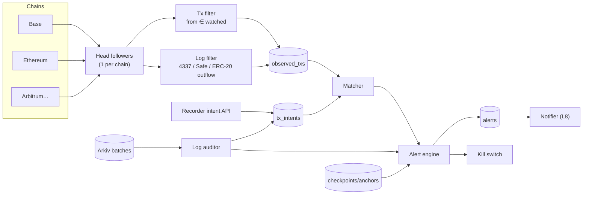

# L6 — Chain Watcher & Alert Engine (`apps/watcher`)

> This is the moat. Log tools see what the agent reports. The watcher sees what the agent's **keys actually did on-chain** and flags the difference.

| | |
|---|---|
| App | `apps/watcher` (chain followers, matcher, log auditor, alert engine), notifier lives in `apps/api` worker (L8) |
| Depends on | `@afr/core`, `@afr/crypto` (HMAC), `@afr/store` (read), `@afr/verifier` (delegations, structural checks), `@afr/secrets` (opens watch keys), `viem`, Postgres, pg-boss |
| Requirements | WAT-01…WAT-10 |
| Phase | P4 (EVM single chain, UNLOGGED_TX, SEQ_GAP, BROKEN_CHAIN, ANCHOR_LAG), P6 (multi-EVM, 4337, Safe, outflow detection, kill switch, flags alerts, self-host mode), P7 (Solana) |

---

## 1. Components



---

## 2. Watched set

- Source: the `watched_addresses` table (L8), populated from agent config (dashboard/API) + the agent profile (privacy ≥ 1) + the ERC-8004 `agentWallet` metadata (suggested).
- Entry: `(tenant_id, agent_key, chain_id, address, kind: eoa|smart_account|safe|session_key, since_block)`.
- Each follower keeps an in-memory `Map<address, WatchEntry[]>` per chain, refreshed through Postgres `LISTEN watched_changed`.
- A new address triggers a **backfill** from `since_block` (bounded to 7 days by default). Deep history is opt-in.

---

## 3. Chain ingestion (EVM)

### 3.1 Head follower

```
state: last_block {number, hash}, ring buffer of last 256 {number → hash}
loop:
  head = ws newHeads (fallback: poll eth_blockNumber every block_time/2)
  for n in last_block.number+1 .. head:
    blk = getBlock(n, includeTransactions: true)
    if blk.parentHash != ring[n-1].hash: handleReorg(n-1); continue
    process(blk); ring[n] = blk.hash; persist cursor (chain_cursors) every block
handleReorg(n):
  walk back until ring[k].hash == getBlock(k).hash → common ancestor k
  mark observed_txs with block > k as 'orphaned'; resolve their pending/unlogged alerts as 'reorged'
  rewind cursor to k; continue
```

- Providers: one primary RPC + one fallback per chain (Alchemy/QuickNode/own node). Each provider gets a circuit breaker.
- The cursor (`chain_cursors`) stores the last block and the ring, so a reorg across a restart is still caught. A reorg deeper than the ring stops the follower with `REORG_TOO_DEEP`, and an operator chooses where to resume.
- Read the head with no client-side cache (viem's `getBlockNumber` otherwise reuses it for a polling interval).
- `confirmations_for_alert` (default 1) sets how many blocks deep a tx must be before `UNLOGGED_TX` fires. The 60 s grace already absorbs most reorgs on L2s.

### 3.2 What counts as "an action by a watched key"

| Pattern | Detection | Identity used for matching |
|---|---|---|
| EOA tx | `tx.from ∈ watched` | `tx.hash`, `(from, nonce)` |
| ERC-4337 user op | `UserOperationEvent(userOpHash, sender, …)` from the EntryPoint (v0.6/v0.7/v0.8 addresses) with `sender ∈ watched` | `userOpHash` |
| Safe | `ExecutionSuccess/ExecutionFailure` emitted by a watched Safe | `safeTxHash` (recorder logs it as `tx_sign.kind = safe`) |
| Session key / delegated EOA (EIP-7702) | `tx.from ∈ watched` (7702-delegated EOAs still send as `from`) | as EOA |
| **Outflow without own tx** | ERC-20 `Transfer(from ∈ watched, to, value)` / ERC-721/1155 transfers in a tx whose sender ∉ watched | (tx.hash, log index) |
| **New approval** | ERC-20 `Approval(owner ∈ watched, spender, value)` or `Permit2` events | (tx.hash, log index) |

Outflow and approval logs come from `eth_getLogs` with `topics[1] ∈ watched` (padded), chunked to ≤ 1,000 addresses per filter, or from `eth_getBlockReceipts` for high address counts.

---

## 4. Matching

### 4.1 Intent sources

1. **Real time:** the recorder outbox `tx_intent` notice (L2 §10), usually under 1 s.
2. **Batch reconciliation:** the log auditor reads `tx_commitments`/`nonce_commitments` from batch public sections on Arkiv. This covers lost notices. An intent counts only if its batch is signed by a valid delegated key.

```sql
-- the tables live in the API schema (ARCHITECTURE §8). tx_intents: migration v1 (API-owned, RLS through
-- agents) + v6 not_mined_at; the rest: v6, owned by the watcher (no RLS)
CREATE TABLE tx_intents (                     -- source 'api': one row per tx_sign
  agent_id uuid, lane int, seq numeric, chain_id bigint NOT NULL,
  tx_commit bytea, nonce_commit bytea NOT NULL, received_at timestamptz NOT NULL,
  not_mined_at timestamptz,                   -- INTENT_NOT_MINED reported once
  PRIMARY KEY (agent_id, lane, seq)
);
CREATE TABLE batch_commitments (              -- source 'arkiv': commitments are shuffled, so not per seq
  agent_id uuid, kind text CHECK (kind IN ('tx','nonce')), commitment bytea, lane int, seq_to numeric,
  received_at timestamptz, PRIMARY KEY (agent_id, kind, commitment)
);
CREATE TABLE reconcile_cursors (agent_id uuid, lane int, next_seq numeric, PRIMARY KEY (agent_id, lane));
CREATE TABLE tx_matches (                     -- the verdict per (observed tx, agent), replaces matched_tx
  chain_id bigint, tx_hash bytea, agent_id uuid,
  kind text CHECK (kind IN ('exact','replacement','late_intent','unlogged')),
  tx_commit bytea, nonce_commit bytea,        -- so an intent arriving after its tx matched isn't "not mined"
  PRIMARY KEY (chain_id, tx_hash, agent_id)
);
```

- **Batch validity (P4-03):** a batch's commitments count if the frame decodes, its public section matches the entity attributes, and `batch_sig` recovers to a listed session key that is (a) registered by the recorder for that lane (`session_keys`, not revoked) and (b) delegated by the agent's operator (L1 §7, `loadDelegations` from `@afr/verifier`) at the batch's write time *t*: `notBefore ≤ t ≤ notAfter + 1 h`, scope RECORDS, no revocation effective at or before *t*. *t* is the entity's Arkiv block time (creation block × 2 s from the head). It is a tighter bound than the verifier's anchor time, because a batch is written before it is anchored. The registration's `afr.arkiv.writers` is the writer filter. Reconciliation stops at a seq gap and resumes when it fills. `local:` agents have no registry, so they aren't reconciled (API intents only).

### 4.2 Algorithm

```
onObservedAction(a):                          // a = EOA tx | userop | safe exec
  W = watch keys of tenants watching a.actor (usually 1)
  for each tenant t:
    c1 = txCommit(W[t], a.chainId, a.hash)            // or userop hash
    if intent(t, tx_commit=c1): mark matched (exact); continue
    c2 = nonceCommit(W[t], a.chainId, a.from, a.nonce) // EOA only
    if intent(t, nonce_commit=c2): mark matched (replacement: sped-up/cancelled tx); info event; continue
    if mode == self && weakMatch(a): mark matched (weak) + warn          // plaintext: to,value,calldata hash, ±5 min
    pending.add(a, t, deadline = a.seenAt + grace)

onIntent(i):                                  // late intents resolve pendings
  for p in pending where commits match: mark matched; if p.alerted → auto-resolve alert "late intent" (keeps a record)

every 5 s: for p in pending where now ≥ deadline and confirmations ≥ N:
  raise UNLOGGED_TX(p)

onOutflow(log):                               // ERC-20/721/1155 from watched in a foreign tx
  if mode == self && exists msg_sign (typed, verifying_contract ∈ {token, Permit2}, spender == tx.from) → info "permit-based transfer (logged permit)"
  else raise UNEXPLAINED_OUTFLOW (high)

onApproval(log) in an unmatched tx → covered by UNLOGGED_TX; in a matched tx with spender not in allowlist (v1 guardrails) → POLICY_BREACH
```

- **Implementation (P4-04):** the pending set is the database, not memory. `sweep()` re-derives it from `observed_txs` rows that have no `tx_matches` verdict (or only `unlogged`, within 1 h), so a restart loses no timer and `onIntent` is simply "sweep now" (LISTEN `afr_intents`, or after a reconciliation). Events: `UNLOGGED_TX`, `TX_REPLACED` (the info event), `LATE_INTENT`, `INTENT_NOT_MINED`; the alert engine (§6, P4-06) turns them into alerts. Watch keys are opened from `watch_keys` (sealed per org, agent key as AAD): the current one and, after a rotation, the previous one, so intents committed before the recorder picked up the new key still match. The trigger on `watch_keys` (NOTIFY `afr_watch_keys`) drops the cached keys.
- **Grace:** default 60 s, configurable 15–600 s per agent (`agents.watch_grace_s`, set through `PATCH /v1/agents/{id}`). A small grace means faster alerts and more false positives during recorder hiccups.
- **Intent never mined:** an intent with no on-chain match after 1 h is an info event (`INTENT_NOT_MINED`: dropped/replaced tx). It feeds the timeline.

---

## 5. Log auditor

Runs continuously per active (agent, lane), every 60 s plus on checkpoint notices. It uses `@afr/verifier` structural functions (L7) incrementally from a per-lane cursor (`last_verified_seq`, `last_chain_root`).

| Check | Alert |
|---|---|
| Next batch's `seq_from` ≠ `last_seq_to + 1` (gap) | `SEQ_GAP` (high) |
| `prev_chain_root` ≠ last `chain_root`, Merkle root mismatch, bad record/batch sig | `BROKEN_CHAIN` (critical) |
| Two different valid batches for the same seq range | `EQUIVOCATION` (critical) |
| Signer not covered by a valid delegation (expired, revoked, wrong lane/agent, bad delegator) | `DELEGATION_MISUSE` (critical) |
| `gap` record present | `RECORDED_GAP` (medium, includes reason) |
| No batch/heartbeat for 3 × heartbeat interval while the agent is marked active | `RECORDER_SILENT` (high) |
| Checkpoint pending > 3 × anchor cadence | `ANCHOR_LAG` (medium) |
| Batch flags (privacy ≥ 1): `has_unapproved_tx` | `UNAPPROVED_HIGH_VALUE` (medium) |
| Batch flags: `has_violation` | `POLICY_BREACH` (high) |
| Batch flags: `has_block` | `POLICY_BLOCK` (info; the system worked) |

**Flag semantics** (computed by the recorder, L2):
- `has_tx`: the batch contains `tx_sign` or `msg_sign`.
- `has_block`: it contains `policy_block`.
- `has_violation`: some record has `policy.decision ∈ {warn, violated}`.
- `has_unapproved_tx`: some `tx_sign` has `value_usd_cents ≥ agent.approval_threshold_cents` and no `approval{decision: approved}` referencing it.

**Implementation (P4-05):** `apps/watcher/src/auditor.ts`, run by the watcher service with the reconciliation pass (every 60 s), from `audit_cursors (agent_id, lane, next_seq, chain_root)`.
- **Which batches count.** Arkiv is open-write, so a batch counts only if it decodes, matches its attributes and its `batch_sig` recovers to a listed session key. A signer delegated for the lane at the batch's Arkiv write time (the §4.1 bound) is valid. A signer we know of (in some operator-signed delegation, or registered by the recorder in `session_keys`) outside that is `DELEGATION_MISUSE`. Any other signer is noise.
- **SEQ_GAP** waits until the later batch is 5 min old on Arkiv (`GAP_WAIT_S`), so an upload in flight isn't a gap. The cursor then moves past it and the next link check is skipped (the missing root is unknown).
- **BROKEN_CHAIN** evidence lists the failed checks (`CHAIN_BREAK`, `MERKLE_MISMATCH`, `RECORD_SIG`, `CHAIN_ROOT_MISMATCH`). The ct hash is already enforced by `decodeFrame`. The chain continues from the batch's own root, so one break doesn't cascade.
- **RECORDER_SILENT**: no batch or heartbeat for 3 × `HEARTBEAT_MS` (180 s) on an active agent's lane. **ANCHOR_LAG**: a checkpoint still pending or validated after 3 × `ANCHOR_CADENCE_S`. Both read Postgres (`agent_lanes`, `checkpoints`) and resolve `fixed` when the condition clears.
- **Not in the hosted auditor:**
  - `RECORDED_GAP` needs the record types (plaintext).
  - A fork published after the auditor passed its range, or an overlapping range, is caught only by the verifier (shortcut; upgrade: a lookback re-scan).

---

## 6. Alert engine

### 6.1 Alert record

```ts
interface Alert {
  id: string;                      // uuid
  tenant_id: string; agent_key: Hex; lane?: number;
  type: AlertType;                 // UNLOGGED_TX | UNEXPLAINED_OUTFLOW | SEQ_GAP | BROKEN_CHAIN | EQUIVOCATION | DELEGATION_MISUSE | RECORDED_GAP | RECORDER_SILENT | ANCHOR_LAG | POLICY_BREACH | UNAPPROVED_HIGH_VALUE | POLICY_BLOCK | INTENT_NOT_MINED
  severity: "critical" | "high" | "medium" | "low" | "info";
  dedupe_key: string;              // e.g. UNLOGGED_TX:<chain>:<txhash>
  status: "open" | "acked" | "resolved" | "suppressed";
  resolution?: "fixed" | "false_positive" | "reorged" | "late_intent" | "expected";
  subject: { chain_id?: number; tx_hash?: Hex; seq_from?: string; seq_to?: string; address?: Hex; batch_key?: Hex };
  evidence: { last_records?: { seq: string; hash: Hex }[]; explorer_url?: string; details?: Record<string, string> };  // no plaintext
  first_seen_at: string; last_seen_at: string; count: number;
}
```

### 6.2 Lifecycle and routing

- Dedupe by `dedupe_key`. Repeats increment `count`.
- Routing rules per tenant: severity → channels (L8 `notification_channels`). Default: critical → all channels + kill switch (if enabled), high → Slack/Telegram/email, medium → email digest, info → dashboard only.
- Suppression windows: maintenance mode per agent, or expected-tx allowlist (e.g. known funding addresses for `UNEXPLAINED_OUTFLOW`).
- Every alert state change is appended to `alert_events` (audit trail). v1: alert state changes are also recorded as AFR records of the tenant's "platform agent" (PLT-04).
- **Implementation (P4-06):**
  - **Raising and auto-resolving.** `apps/watcher/src/alerts.ts` `PgAlerts` dedupes on `(org_id, dedupe_key)`. A repeat increments `count` and doesn't notify. A repeat of a resolved alert, or of a suppressed one past `suppressed_until`, reopens it and notifies again.
  - **Routing.** Each state change calls `afr_route_alert(alert, event)` (migration v8). It queues a `deliveries` row for every enabled channel of the org whose `min_severity` ≤ the alert's severity and whose `agent_filter` (if any) holds the agent. Routing is per channel, by minimum severity; the default rules above are a channel's settings, not built in.
  - **Severities.** `UNLOGGED_TX` is critical, `INTENT_NOT_MINED` info; the others follow §5.
  - **Matcher events.** `UNLOGGED_TX` opens `UNLOGGED_TX:<chain>:<tx>`. `LATE_INTENT` resolves it as `late_intent` (W4), and an orphaned tx resolves it as `reorged` (W3). `INTENT_NOT_MINED` is an info alert. `TX_REPLACED` stays a log event.
  - **Not yet:** suppression windows per agent and expected-tx allowlists. Today a user suppresses one alert until a time, at most 30 days.

### 6.3 Kill switch (v1)

```
on alert(type ∈ kill_switch.on, severity == critical):
  actions = agent.kill_switch.actions   // ordered
    - revoke_session_key: publish afr.revocation.v1 (operator KMS or pre-signed revocation) → recorder stops signing
    - pause_account: call AfrKillSwitchModule.pause() with guardian key (L5 §5)
    - webhook: POST signed payload to customer endpoint (customer revokes keys/stops agent)
  record outcome in alert evidence; notify
```

Pre-signed revocations: during delegation, the operator can also sign a `Revocation` for the same session key with `effectiveAt = 0`. The API stores it (encrypted) for emergency use.

---

## 7. Deployment modes

**Service (`apps/watcher`, `node dist/main.js`):** one process per watched chain, one leader per chain (pg advisory lock `0xafa0c5 << 32 + chain_id`). Every 2 s: follow the head. Every 5 s, and on NOTIFY `afr_intents`: sweep the matcher. Every 60 s: reconcile every active lane. It holds two dedicated connections: the lock, and one LISTEN for `watched_changed`, `afr_intents` and `afr_watch_keys`. Env: `AFR_PG_URL`, `AFR_WATCH_RPC_URL`, `AFR_WATCH_CHAIN_ID` (84532), `AFR_IDENTITY_RPC_URL`, `AFR_IDENTITY_CHAIN_ID` (84532), `ARKIV_ACCESS_KEY` (read-only store), and the API's KEK (`AFR_KMS_ENVELOPE_KEY_ID`, or `AFR_API_LOCAL_KEK` for dev). Image: `service.Dockerfile` with `APP=watcher`.

| Mode | Matching | Plaintext | Who runs it |
|---|---|---|---|
| `hosted` | HMAC commitments | never | AFR cloud (watch keys KMS-encrypted in DB, decrypted in memory) |
| `self` | HMAC + weak plaintext match + permit correlation | yes (reader key) | customer (`docker run afr/watcher --mode self`), alerts posted to AFR API or straight to the customer's channels |
| `public` | raw tx hashes (privacy ≥ 1 with `watch_mode: public`) | no | anyone (counterparties, open-source) |

---

## 8. Solana (P7)

- Ingestion: Geyser/Yellowstone gRPC or a provider webhook (Helius), filtered by account keys (watched addresses as **signers**).
- Identity: the tx signature (base58) → `tx_commit = HMAC(watch_key, "AFR_SOL_TX_V1" ‖ sig64)`.
- Recorder hook: wrap `@solana/kit` `signTransaction`/`sendTransaction`, recording a `tx_sign` with `chain_id = "solana:mainnet"` (CAIP-2 string in `meta`, `tx.chain_id = 0` sentinel) and the signature.
- Outflow: SPL Token `Transfer`/`TransferChecked` with the source owned by a watched address and the signer not watched (delegate spends).

---

## 9. Scale and performance

- One follower process per chain. The matcher is stateless (Postgres). Shard by chain, then by tenant hash if needed.
- Target: block processing p95 < 500 ms after receipt. Alert latency (inclusion → notification) p95 < 90 s with the default grace.
- The in-memory watched-set lookup is O(1). Base handles ~200 tx/block every 2 s with negligible CPU.

---

## 10. Tests and acceptance criteria

| # | Test |
|---|---|
| W1 | Anvil E2E: logged tx (via SDK) → matched, no alert. Raw tx from the same key (cast send) → `UNLOGGED_TX` after the grace |
| W2 | Speed-up (same nonce, higher fee) of a logged tx → matched via nonce commit, info event |
| W3 | Reorg on Anvil (`anvil_reorg`/snapshot revert) → orphaned tx alert auto-resolved `reorged` |
| W4 | Late intent (notice dropped, arrives via Arkiv batch 40 s later) → no alert. 90 s later → alert then auto-resolve `late_intent` |
| W5 | Seq gap / broken chain / equivocation / delegation misuse fixtures → the right alerts ✓ (`apps/watcher/test/auditor.test.ts`; batch-level tampering from the verifier's V1/V5 fixture: the record-level `test-vectors/negative` cases need plaintext, which the hosted auditor never has) |
| W6 | `transferFrom` by a third party draining an approved token → `UNEXPLAINED_OUTFLOW` |
| W7 | 4337: userop through a bundler on Anvil (EntryPoint deployed) → matched by userOpHash. Unlogged userop → alert |
| W8 | Watcher restart mid-stream → no missed blocks (cursor), no duplicate alerts (dedupe) |
| W9 | Canary: hourly unlogged tx in staging produces exactly one alert, auto-acked ✓ (`tools/e2e/test/canary.anvil.test.ts` against the real service; on staging the `afr-staging-canary` service, P4-07) |
| W10 | Alert payloads contain no plaintext (schema test) ✓ (`apps/api/test/alerts.test.ts`: strict alert schema on responses and webhook payloads; a prose canary is never sent) |

## 11. Vibecoding prompts

1. "Create `apps/watcher` with a head follower for one EVM chain (viem `watchBlocks` with `includeTransactions`, poll fallback), ring buffer reorg handling and a `chain_cursors` table (L6 §3.1). Test W3 and W8 on Anvil."
2. "Add the watched set (in-memory Map + LISTEN/NOTIFY) and the tx filter. Add `tx_intents` + `observed_txs` tables and the matcher in L6 §4.2 using `@afr/crypto` HMAC commitments. Test W1, W2, W4."
3. "Implement the log auditor (L6 §5) using `@afr/verifier` structural functions with per-lane cursors. Test W5 with negative vectors."
4. "Implement the alert engine (L6 §6) with dedupe, lifecycle, routing to a `notify` pg-boss queue. Schema test W10."
5. "(v1) Add log filters for 4337 UserOperationEvent and ERC-20 Transfer/Approval with topics[1] ∈ watched; implement UNEXPLAINED_OUTFLOW (W6, W7)."
