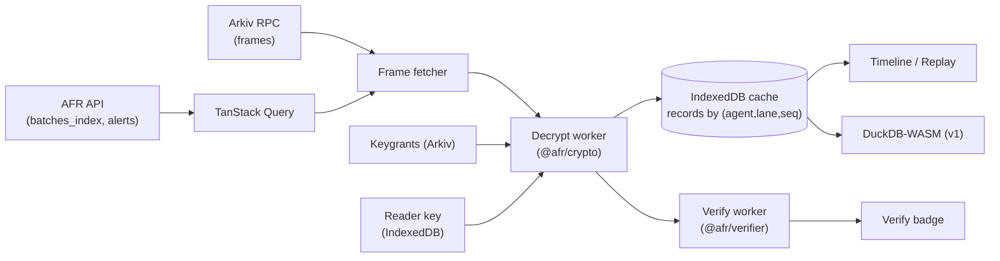

# L9 — Dashboard (`apps/dashboard`)

> The product people pay for. It turns the log into answers during an incident and into evidence for an audit, **while decrypting only in the user's browser**.

| | |
|---|---|
| App | `apps/dashboard`: static SPA (ADR-026). Vite, React 19, TypeScript, Tailwind, TanStack Query (+ Table + Virtual when the timeline needs them), viem + SIWE with the injected wallet, Web Workers, IndexedDB (`idb`), DuckDB-WASM (v1 search), Recharts. Served from the API's origin (the `__Host-` session cookie is `SameSite=Strict`) |
| Depends on | `@afr/client` (API), `@afr/store` (browser Arkiv reader), `@afr/crypto`, `@afr/verifier`, `@afr/core` |
| Requirements | DSH-01…DSH-12, PRV-07, C18–C21, C27 |
| Phase | P4 (agents, timeline, replay, alerts, verify badge, key onboarding), P6 (search, grants, packs, policy editor, approvals, public pages) |

---

## 1. Information architecture

```
/                         → redirect to /o/{org}/agents (or /login)
/login                    SIWE
/o/{org}/agents           Agent list
/o/{org}/agents/new       Add agent wizard
/o/{org}/agents/{id}      Agent overview (status, lanes, last anchor, alerts, verify badge)
/o/{org}/agents/{id}/timeline?lane&from&to&type&q     Timeline
/o/{org}/agents/{id}/replay/{seq}?before=40&after=10  Replay
/o/{org}/agents/{id}/search            (v1) local query
/o/{org}/agents/{id}/evidence          (v1) packs, disclosures, attestations
/o/{org}/agents/{id}/access            (v1) readers, grants, revocation, shredding
/o/{org}/agents/{id}/policy            (v1) editor + dry-run
/o/{org}/agents/{id}/settings          privacy, retention, watched addresses, kill switch, recorder keys, ERC-8004 registration
/o/{org}/alerts                        Alerts inbox
/o/{org}/approvals                     (v1) approvals inbox
/o/{org}/settings                      members, channels, billing, API keys
/keys                                  Reader key manager (local)
/a/{agentId}                           (v1) public agent page (no login)
```

---

## 2. Key onboarding (first-run, mandatory before decryption)

1. "Create your reader key." The browser generates X25519 (WebCrypto non-extractable if supported, else noble). The public key is shown as a fingerprint.
2. The user signs `ReaderKey` EIP-712 with their wallet, and the dashboard publishes `afr.readerkey.v1` + registers with the API.
3. **Forced backup:** the user downloads `.afrkey` encrypted with a passphrase (zxcvbn strength ≥ 3) and must re-type the fingerprint's last 4 characters to confirm.
4. On adding an agent, the operator's reader key becomes the default reader. The recorder config gets it on the next poll.
5. On a new device: import `.afrkey`, or skip, and the dashboard works in **metadata-only mode** (timeline shows seq/type/flags from public data, but bodies show 🔒).

Banner rules: "This key is the only way to read your agent's history. AFR can't recover it."

---

## 3. Data pipeline in the browser



- **Frames come from Arkiv directly** (or the Postgres mirror via the API as fallback, labelled "mirror"). The API index is only for speed. The verify worker re-checks everything.
- **Decrypt worker:** for each batch, find the epoch keygrant for this reader → HPKE open → KEK (cached in memory for the session, never persisted) → DEK → decrypt → parse headers/bodies → verify each header hash against the public record hash (mismatch → the record is shown with a red "integrity failure" ribbon).
- **Cache:** decrypted records sit in IndexedDB, encrypted at rest with a session key derived from the reader key (so a stolen laptop profile without the passphrase doesn't leak them). "Clear local data" button. TTL is configurable (default 7 days).
- **Window loading:** the timeline loads the visible window ±200 records, prefetching as you scroll (virtualised).

---

## 4. Views

### 4.1 Agent list

Columns: name · agent ID (short) · status (active/paused/silent) · last action · last anchor (age, colour-coded vs. cadence) · open alerts by severity · privacy level · retention · verify badge. Filters: status, has critical alerts. Row click → overview.

### 4.2 Agent overview

- Header: name, ERC-8004 ID (link to registry/explorer), operator address, verify badge (structural ✔ / full ✔), "Verify independently" (copies the CLI command).
- Cards: actions (24 h / 7 d), txs + value moved (decrypted, computed locally), approvals vs. unapproved, policy blocks, open alerts, store lag, anchor lag, session key expiry, journal health (from heartbeat).
- Lanes table: lane, recorder version, last seq, last heartbeat.
- Mini timeline: last 20 actions.

### 4.3 Timeline

Virtualised table, one row per record:

| Col | Content |
|---|---|
| seq | `#12,844` (mono) |
| time | local time, with recorder `ts` and anchor time on hover |
| type | icon + label (model_call, tool_call, tool_result, tx_sign, tx_broadcast, msg_sign, approval, policy_block, gap, note) |
| summary | model id / tool `server.name` / tx `to` (ENS/label), value (token + USD) / approval decision |
| policy | decision chip (allow/warn/require_approval/deny/violated) |
| approval | ✔ eip712 / ✔ attested / – |
| integrity | ✔ / ✖ (header hash) / ⚓ anchored |

Grouping: `tool_call` + `tool_result` (by `ref_seq`) collapse into one expandable row with duration. `tx_sign` + `tx_broadcast` + on-chain status (from the watcher) collapse into one row with an explorer link.

Filters: type, tool, model, tx only, value ≥, unapproved, policy decision, time range, session, lane. Text search over decrypted fields runs locally on the current window (P4), or across everything through DuckDB (v1).

Gaps: `gap` records and watcher-detected `SEQ_GAP`s render as red full-width separators ("Records 1200–1210 missing: recorder disk full (signed gap record)" vs. "Unexplained gap: alert #…").

Unlogged transactions: watcher `UNLOGGED_TX` alerts are **interleaved** at their chain time as red rows ("On-chain tx with no recorded intent"). This is the demo moment.

### 4.4 Replay

Purpose: "Replay the 40 actions before the bad trade."

Layout (three panes, keyboard driven):
- **Left:** compact list of the N actions around the pivot (pivot highlighted). `j/k` steps, `Enter` focuses.
- **Centre:** the focused action's full detail:
  - `model_call`: system prompt, messages, tool definitions (collapsible), output. Diff against the previous model call's context ("what changed since last turn"), which is where injected content stands out.
  - `tool_call/result`: args and result as a JSON tree plus raw view. MCP content blocks rendered as **inert text** (no HTML/markdown execution, links not auto-clickable, images only if `capture.binary: full` and shown as blob URLs with CSP).
  - `tx_sign`: decoded calldata (ABI via Sourcify/Etherscan lookup or a local ABI registry), simulation link (Tenderly, optional), on-chain result.
  - `approval`: who, method, signature verification result.
- **Right:** context rail: policy evaluation, commitments (✔ recomputed), Merkle proof (copy), batch/anchor links, related alerts.
- Controls: play/pause auto-step (1 s), jump to next tx/approval/block/alert, mark as incident, add note.
- Notes: by default a dashboard note is an API annotation, labelled "operational, not evidence". "Sign note as evidence" (v1) sends an operator-signed note through the API to the recorder, which records it as a `note` record in the chain.

### 4.5 Alerts

Inbox with severity tabs, grouped by agent. Detail page: what was detected, evidence (tx link, missing seqs, signer), linked timeline position ("open in replay"), actions (ack, resolve with reason, suppress, run kill switch), history (alert_events).

### 4.6 Search (v1)

- DuckDB-WASM table `records(agent_key, lane, seq, ts, type, model, tool, chain_id, to, value_wei, value_usd_cents, approved, policy_decision, rule_id, args_json, result_json)`, filled from the IndexedDB cache.
- Preset queries: "Trades > $10k without approval", "All txs to new counterparties", "Tool errors before txs", "Model version changes".
- Builder UI + raw SQL (power users). Results link into replay. Export CSV (local).

### 4.7 Evidence (v1)

- **Export pack:** choose range, mode (decrypted/sealed for a reader/disclosure), progress (decrypt + build zip in a worker), sign the manifest with the operator wallet, download.
- **Disclosures:** select records + fields → `disclosure.json`.
- **Attestations:** list. Invite an auditor to attest.

### 4.8 Access (v1)

Readers table (operator, auditors) with the epochs they can read. "Grant history" wizard (range → epochs → browser re-wraps → publish keygrants → done). Revoke (with the "past access can't be withdrawn" warning). Shred epoch (typed confirmation, irreversible).

### 4.9 Policy editor (v1)

YAML editor (Monaco) with schema validation. A visual rule list beside it. **Dry-run:** evaluate the draft against the last N days of decrypted actions (in the browser, using `@afr/policy`) and show "would have blocked 3, required approval for 12". Activate → the API stores the version → the recorder pulls it.

### 4.10 Approvals inbox (v1)

Pending requests with a summary (decrypted locally if the summary is encrypted to approvers), the policy rule that triggered it, and countdown to expiry. Approve/Reject as **EIP-712 with the wallet** (strong) or one-click attested (if the policy allows).

### 4.11 Public agent page (v1)

`/a/{agentId}`: name, ERC-8004 identity, live structural verification (runs in the visitor's browser), last anchor, records count, gaps (0), attestations, flags at privacy ≥ 1 ("0 unapproved transactions in 90 days"). Embeddable badge ``.

---

## 5. Security

- **CSP:** `default-src 'self'; script-src 'self' 'wasm-unsafe-eval'; connect-src 'self' <api> <arkiv rpc> <base rpc>; img-src 'self' blob: data:; frame-ancestors 'none'`. No third-party analytics scripts on authenticated routes (product analytics are server-side events only, with no content).
- **Decrypted content is untrusted data.** Never use `dangerouslySetInnerHTML`. Never send decrypted content to any server, LLM or analytics. ESLint rule bans `fetch` in modules that import decrypted types (`@afr/dashboard/decrypted`).
- Reader key: never leaves the browser except as the user-initiated encrypted backup.
- Clipboard copy of sensitive values shows a toast warning.
- Session: SIWE cookie. Re-authenticate for grants, shredding and policy activation (wallet signature).
- Subresource integrity for DuckDB WASM assets (self-hosted).

---

## 6. Design system

- shadcn/ui on Tailwind, with tokens for light and dark. Mono font for hashes and seqs (JetBrains Mono / IBM Plex Mono). Shortened hashes with copy + full value on hover.
- Severity colours: critical red-600, high orange-500, medium amber-400, low sky-500, info slate-400, used consistently in alerts, timeline ribbons and the badge.
- Every chart and colour state also has a text/icon equivalent (WCAG 2.2 AA). Everything is keyboard navigable (timeline j/k, replay arrows).
- Empty states teach: "No actions yet → point your agent at `fr-proxy`" with a copy-paste snippet.

---

## 7. File layout

```
apps/dashboard/
├─ index.html, vite.config.ts      (CSP meta injected at build)
├─ src/main.tsx, app.tsx           (QueryClient, 401 → /login, shell + org switcher)
├─ src/pages/{login,agents,agent}.tsx, later timeline, replay, alerts, keys, …
├─ src/components/{link,ui}.tsx, later timeline, replay, alerts, badge, keys, json-tree, tx-decoder, policy-editor
├─ src/workers/{decrypt.worker.ts, verify.worker.ts, pack.worker.ts}
├─ src/lib/{api.ts, route.ts, format.ts, siwe.ts}, later arkiv.ts, cache.ts (idb), keys.ts, duck.ts
├─ test/*.test.ts (Vitest, pure lib code)
└─ e2e/*.spec.ts (Playwright)
```

Routes (§1) are parsed in `src/lib/route.ts` on the History API.
- **Local dev:** `pnpm --filter @afr/dashboard dev` proxies `/v1` to the API, set with `AFR_API_URL` (default `http://127.0.0.1:8080`), so the cookies stay same-origin. The API needs `AFR_SIWE_DOMAIN=localhost:5173`.

## 8. Tests and acceptance criteria

| # | Test |
|---|---|
| D1 | E2E (Playwright, local stack): login → add agent → key onboarding → recorder sends 100 actions → timeline shows 100 decrypted rows → replay works |
| D2 | Unlogged tx alert appears as an interleaved red row within 90 s (local Anvil) |
| D3 | Tampered frame in the mirror → integrity ribbon + verify badge ✖ |
| D4 | No network request contains decrypted canary strings (Playwright request interception) |
| D5 | Lighthouse a11y ≥ 95 on main views. Axe has no serious violations |
| D6 | Timeline handles 1M records (virtualised; IndexedDB windowing) at 60 fps scroll on a mid-range laptop |
| D7 | Metadata-only mode works without a reader key |

## 9. Vibecoding prompts

1. "Scaffold `apps/dashboard` (Vite + React SPA per ADR-026, Tailwind, TanStack Query, viem SIWE login against `@afr/client`). Build the agent list and overview pages from the API client."
2. "Implement key onboarding (§2) using `@afr/crypto` reader keys, the `.afrkey` backup and ReaderKey EIP-712 signing with wagmi."
3. "Implement the decrypt worker and IndexedDB cache (§3). Frames from Arkiv via `@afr/store` browser reader with API-mirror fallback. Include header-hash checks."
4. "Build the virtualised timeline (§4.3) with grouping of call/result and sign/broadcast, gap separators, and interleaved watcher alerts."
5. "Build the replay view (§4.4) with keyboard navigation, context diffs between model calls, inert rendering of MCP content, and the context rail."
6. "Add the verify worker and badge (§4.2/L7 §7). Then Playwright tests D1–D4, D7."
